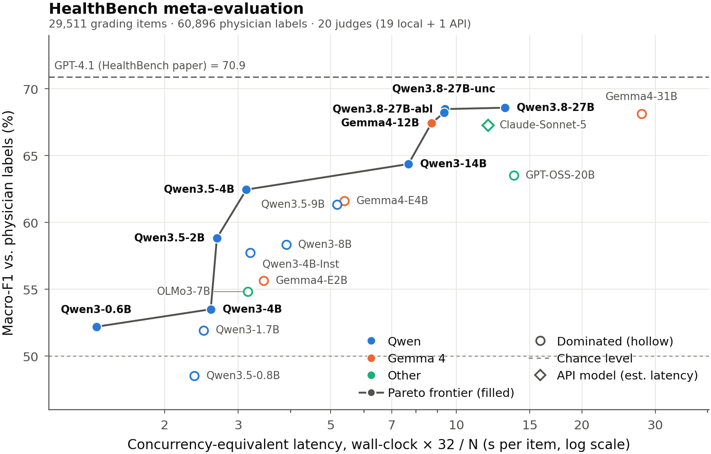
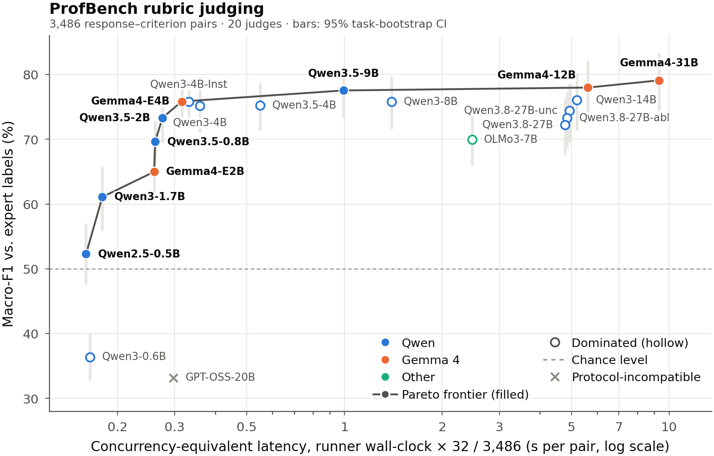
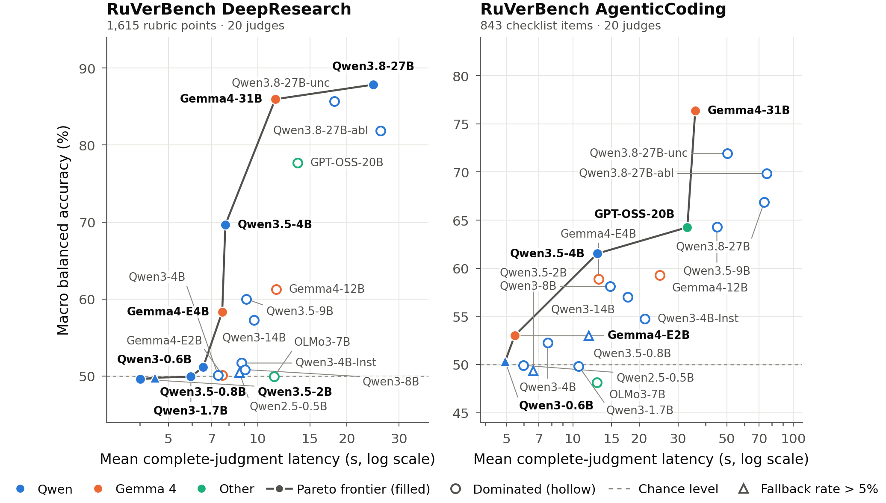
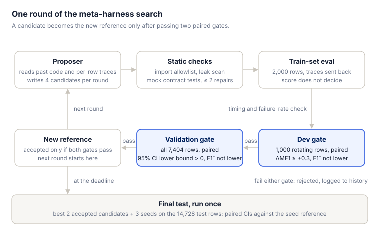
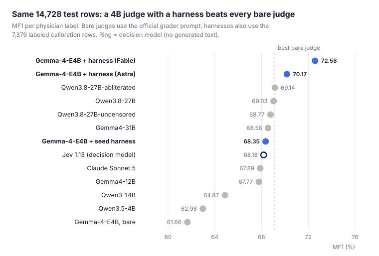
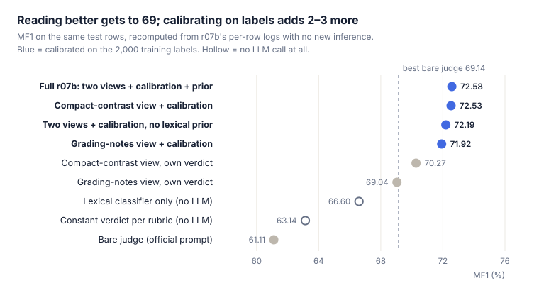
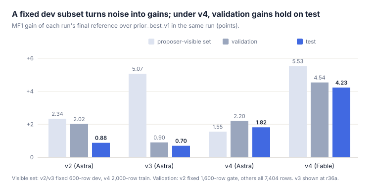
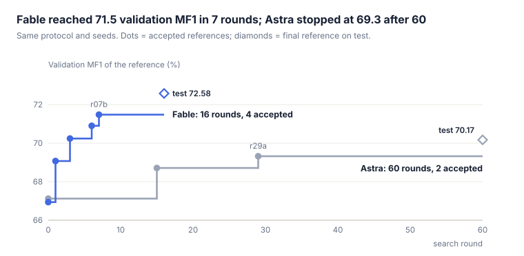

这篇整理我们在 LLM-as-a-judge 上做的两组实验，都做在我们转向 Jev 式决策模型（见[上一篇](../jevany-robotics/)）之前。

第一组是系统测评：在 HealthBench 元评测（[Arora et al., 2025](https://arxiv.org/abs/2505.08775)）、ProfBench（[Wang et al., 2025](https://arxiv.org/abs/2510.18941)）和 RuVerBench（[Peng et al., 2026](https://arxiv.org/abs/2606.29920)）三个 rubric 评测上，用同一套流程测了 21 个生成式 judge，再和只输出选项概率、不生成文本的决策模型 Jev 1.13（[TypeSafe](https://docs.typesafe.ai/introduction)）对比。第二组是 meta-harness：不改模型权重，从手工迭代和早期搜索得到的种子出发，让强模型自动改写一个 4B 小 judge 的外围代码（harness），思路与 Meta-Harness（[Lee et al., 2026](https://arxiv.org/abs/2603.28052)）相近。在 HealthBench 元评测上，Gemma-4-E4B 的 test MF1 从 61.1（裸判）经 68.4（种子）提到 72.6。

# 1 结论

1. **没有全能冠军。** HealthBench 上最好的是 Qwen3.8-27B（MF1 68.59），ProfBench 上是 Gemma4-31B（79.08），RuVerBench 的 DR 和 AC 两个域分别由 Qwen3.8-27B 和 Gemma4-31B 领先。没有一个模型达到 HealthBench 论文里 GPT-4.1 的 70.9。
2. **最普遍的偏向是放行。** HealthBench 和 RuVerBench 上，几乎所有模型的错误放行率都高于错误拒绝率（HealthBench 上 18 个共有模型平均 61.1% 对 17.3%）。ProfBench 没有这个规律。
3. **参数量不是充分条件。** Qwen3.5-4B 在 RuVerBench-DR 上拿到 69.65，高于所有 7B–14B 模型；Qwen3.8-27B 在 ProfBench 上却低于四个 4B 模型。
4. **决策模型 Jev 1.13 和最好的生成式 judge 只差不到 1 分。** 它在 HealthBench 全量上是 67.74（低 0.85），ProfBench 上是 79.76（高 0.68），单次请求只要 0.4–0.5 秒；但它做不了需要自己检索、写理由的 RuVerBench。
5. **4B judge 加上自动搜出来的 harness，在同一批 test 行上超过所有裸判模型。** 14,728 行 test 上，Gemma-4-E4B 从 61.11 升到 72.58，负类 F1 从 37.47 升到 56.83；同一批行上最好的裸判模型是 69.14，Jev 是 68.18。
6. **提升主要来自让模型读得更准，再在标签上校准。** 由医生标注提炼的“评分要点”和同 rubric 正反例负责读得准，一个在标签上拟合的小逻辑回归负责校准判决的 log-odds。但标签本身信息量很大：只按 rubric 给常数判决就有 63.1，只用词汇分类器、完全不调用 LLM 有 66.6。所以“4B 超过 27B”应理解为“4B + 7,379 行医生标注 + harness”超过“不看标签的 27B 裸判”。
7. **验收规则很关键。** 固定 dev 子集会把噪声当成增益（v3 在 dev 上 +5.1，test 只 +0.7）。v4 把提案者拿到逐行痕迹的行和门控抽样的行分开，并要求全量验证的配对区间下界大于 0（同时也改了其他几项设置），之后验证集上的增益在 test 上兑现了。
8. **提案者差别很大。** 同一协议、同一组种子下，Claude Fable 用 16 轮拿到 +4.2，gpt-6-astra 用 60 轮拿到 +1.8。两者各只跑了一次。

# 2 生成式 judge 的系统测评

## 2.1 测了什么

我们测的是裸判能力：给定材料和一条评分标准，判断“满足 / 不满足”，再和人工标签比。三个评测如下。

| 评测 | 判断什么 | 规模 | 真实负类占比 | 主指标 |
| --- | --- | --- | --- | --- |
| HealthBench 元评测 | 模型回答是否满足医生写的一条 rubric | 29,511 行，60,896 个医生标签 | 23.0% | MF1：正、负类 F1 的平均，逐个医生标签计 |
| ProfBench | 专业报告是否满足专家 rubric | 3,486 对（40 个任务） | 49.7% | Macro-F1；另报偏差校正后的 MF1-BI |
| RuVerBench | 深度研究报告（DR）或编码 agent 轨迹（AC）是否满足 rubric / checklist | DR 1,615 条，AC 843 条 | DR 60.9%，AC 17.2% | 各类别平衡准确率的平均（AvgBAcc），两个域分开报 |

**模型。** 21 个：Qwen3 / Qwen3.5 / Qwen3.8 系列（0.6B–27B，含两个去审查的 27B 变体）、Gemma-4（E2B、E4B、12B、31B）、GPT-OSS-20B、OLMo-3-7B、Qwen2.5-0.5B，以及 Claude Sonnet 5。Claude Sonnet 5 只测了 HealthBench，Qwen2.5-0.5B 没测 HealthBench，所以每个评测各 20 个模型。

**协议。** HealthBench 用 simple-evals（[OpenAI](https://github.com/openai/simple-evals)）的官方 grader prompt，temperature 0，结构化 JSON 输出；ProfBench 用官方 prompt（[NVlabs/ProfBench](https://github.com/NVlabs/ProfBench)），只答 Yes / No；RuVerBench 用我们自己的检索式 harness，模型在这个 case 自己的文档里搜索、翻页，最后提交判决、理由和引文。支持开关的本地模型都关了思考模式，只有 Gemma4-31B 的 HealthBench 结果是开启思考重跑的；Claude 经 <code>claude -p</code> 调用，temperature 和思考都控制不了，约 40% 的调用触发了 extended thinking。

**硬件。** 本地模型全部用 vLLM 跑在 A100-40GB 上，27B 和 31B 用两张卡（GPT-OSS-20B 的 HealthBench 计分作业也用了两张）。

三个评测的提示、输出预算和工具协议都不同，分数不能跨评测比较难度。下文都在单个评测内部做比较。

## 2.2 质量与成本：Pareto 前沿

每个评测上最好的 judge 都要用两张卡。按 GPU 成本算，它是前沿上 4B 模型的 8 到 60 倍（HealthBench 约 8 倍，RuVerBench 约 16 倍，ProfBench 约 60 倍）；按图中的延迟算差距小一些，HealthBench 和 RuVerBench 上约 3–4 倍，ProfBench 上约 30 倍。多花的成本换来多少分因评测而异：ProfBench 上 4B 级别已经接近饱和，HealthBench 和 RuVerBench 上大模型仍明显领先。

***图 1** HealthBench 元评测，20 个 judge。横轴是并发折算延迟（墙钟 × 32 / 条数，对数坐标），纵轴是逐医生标签计的 MF1。实心点在 Pareto 前沿上，空心点被前沿支配（存在更快且更准的模型）；菱形是 API 模型，延迟为估计值；顶部虚线是 HealthBench 论文里 GPT-4.1 的 70.9。*

**HealthBench。** 前沿从 Qwen3-0.6B（52.20，1.37 秒）延伸到 Qwen3.8-27B（68.59，13.07 秒）。Qwen3.5-4B 用 3.14 秒拿到 62.46，高于 Qwen3-8B（58.35）和 Qwen3.5-9B（61.33）。Claude Sonnet 5 的 67.27 被 Gemma4-12B（67.44，8.72 秒）支配，但它的负类 F1（53.28）是全场最高。前几名差距不到 1 分，没有做显著性检验。

***图 2** ProfBench，3,486 个回答–标准对。竖条是按任务重采样的 95% 区间；叉号是协议不兼容的 GPT-OSS-20B（只输出 Harmony 控制符，33.19 不代表能力）。*

**ProfBench。** 曲线过了 0.3 秒几乎变平。Gemma4-E4B（75.82，0.32 秒）到 Gemma4-31B（79.08，9.32 秒）只差 3.3 分，延迟却差约 30 倍。Qwen3.8-27B 只有 72.19，低于四个 4B 模型。

***图 3** RuVerBench 的 DR（1,615 个 rubric 点）和 AC（843 个 checklist 项）。横轴是一次完整判断（含全部工具轮次）的实测平均耗时，纵轴是 AvgBAcc，虚线是随机水平；三角表示该域有超过 5% 的判断因协议失败触发了随机兜底。*

**RuVerBench。** 大小模型的差距在这里最大。DR 上 Qwen3.8-27B 87.84、Gemma4-31B 85.95；4B 及以下的模型里只有 Qwen3.5-4B（69.65）和 Gemma4-E4B（58.33）明显高于 50，其余都在随机水平附近。AC 上 Gemma4-31B（76.36）领先，Qwen3.8-27B 只有 66.85。

横轴口径要分开看：HealthBench 和 ProfBench 是并发折算延迟，RuVerBench 是一次完整判断的实测平均耗时，两者不能混排。Claude 走订阅配额，延迟是去掉限流停顿后的估计。

## 2.3 与决策模型 Jev 的对比

Jev 1.13（[TypeSafe](https://docs.typesafe.ai/introduction)）是一个决策模型：只返回选项和概率，不生成文本。在能套用的两个评测上，它和最好的生成式 judge 相差不到 1 分（HealthBench 低 0.85，ProfBench 高 0.68），而单次请求只要约 0.4–0.5 秒。

| Judge | HealthBench MF1（全量） | ProfBench Macro-F1 | RuVerBench DR / AC | HealthBench 耗时 | ProfBench 耗时 |
| --- | --- | --- | --- | --- | --- |
| Jev 1.13（API） | 67.74 | **79.76** | 无法评测 | 0.42 秒（单次请求） | 0.46 秒（单次请求） |
| Qwen3.8-27B（2 卡） | **68.59** | 72.19 | 87.84 / 66.85 | 13.07 秒 | 4.78 秒 |
| Gemma4-31B（2 卡） | 68.12 | 79.08 | 85.95 / 76.36 | 27.80 秒（下界） | 9.32 秒 |
| Gemma4-12B | 67.44 | 77.97 | 61.28 / 59.27 | 8.72 秒 | 5.62 秒 |
| Claude Sonnet 5（API） | 67.27 | – | – | 约 11.9 秒（估计） | – |
| Gemma4-E4B | 61.62 | 75.82 | 58.33 / 58.88 | 5.39 秒 | 0.32 秒 |

本地模型的耗时是并发折算延迟（Gemma4-31B 的 HealthBench 是开思考的重跑，耗时由两段部分作业相加，是下界）；Jev 是客户端测到的单次请求耗时，含网络，ProfBench 上套上 18 次/秒的限速后折算为 1.78 秒。Jev 跑完 HealthBench 全量 29,511 条花了 1.42 美元，ProfBench 3,486 条花了 0.31 美元。

几个需要一起看的细节：

- **口径不同。** HealthBench 上 Jev 走原生的选项 / 概率接口，p ≥ 0.5 判满足，没有复现官方 grader prompt；ProfBench 上保留了官方提示文字和计分器，但改用 Jev 原生的选项接口（加了 Yes / No 两个选项描述），直接取它返回的选项。数据和计分函数相同，但这是接口适配后的结果，不是同一协议。
- **RuVerBench 做不了。** 我们的 RuVerBench 协议要求模型自己生成搜索词、笔记、理由和引文，Jev 的接口没有自由文本输出，所以记为协议不兼容，不是 0 分。
- **错误集中在特定 rubric。** HealthBench 上 Jev 的正、负类 F1 是 84.63 / 50.85，AUROC 0.75。“复杂回答—详细准确性与不确定性表达”这一类（644 条）它几乎全判不满足，正类召回只有 5.9%；沟通类和急诊转诊类则反过来放行偏多，医生判不满足的标签分别有 63.6% 和 58.7% 被它判成满足。所以不能简单说它偏宽或偏严。
- **概率可以校准，但不提分。** 原始概率偏低：按标签加权的平均 p 为 65.6%，实际有 77.0% 的标签为真。按对话五折交叉验证，调阈值只多 0.08 分；Platt 校准把 ECE 从 11.4% 降到 0.8%，但不改变排序，MF1 不会因此提高。
- **医生之间的参照。** 拿每位医生的标签去对其他医生（按与模型评测相同的权重），得到的 MF1 约为 69.22；Jev 低 1.48 分（对话重采样区间 [0.69, 2.32]）。换一种汇总口径，这个参照会在 67.2 到 69.6 之间变化。
- **不是所有决策模型都这样。** 另一个决策模型 Laya 在 HealthBench 全量上只有 48.89，接近随机。

## 2.4 跨评测看到的规律

这批 judge 最普遍的偏向是放行：HealthBench 和 RuVerBench 上，几乎所有模型的错误放行率（FPR，真实负类被判满足的比例）都高于错误拒绝率（FNR），但这个规律在 ProfBench 上不成立。这是条件错误率的比较；按绝对次数，负类只占 17% 的 AC 上错误拒绝反而更多。下表是三个评测共有的 18 个本地模型。

| 评测 | FPR 高于 FNR 的模型数 | 平均 FPR | 平均 FNR |
| --- | --- | --- | --- |
| HealthBench | 17 / 18 | 61.14% | 17.30% |
| ProfBench | 6 / 18 | 27.77% | 27.11% |
| RuVerBench-DR | 18 / 18 | 73.12% | 4.47% |
| RuVerBench-AC | 16 / 18 | 61.53% | 18.61% |

DR 的真实负类占 60.9%，仍然 18 个模型全部放行偏多，所以这不是“负类少所以放行”。逐条复核里见到的失败类型包括：只要回答提到了相关主题就当成满足；把 rubric 或背景知识补写成原文证据；理由说对了，布尔值却映射反了。这些来自定向抽取的少量案例，不代表各类错误的占比。

其他几条规律（这里跨评测统一用 MF1，即正、负类 F1 的平均，所以 RuVerBench 的数值和第 6 节表里的 AvgBAcc 不同）：

1. **没有全能冠军。** Gemma4-31B 在 ProfBench 和 AC 第一、DR 第二、HealthBench 第四；Qwen3.8-27B 在 HealthBench 和 DR 第一，ProfBench 却只有 72.19。单个评测上的好成绩不能直接迁移：Gemma4-12B 在 HealthBench 和 ProfBench 的 MF1 是 67.44 和 77.97，在 DR 只有 50.47。
2. **参数量不是充分条件。** Qwen3.5-4B 的 DR（64.86）高于所有 7B–14B 模型。同系列 Qwen3-4B 到 14B，HealthBench 和 DR 的 MF1 分别涨 10.87 和 16.89，ProfBench 只涨 0.87（区间含 0），AC 反而降 2.33（区间同样含 0；按 AvgBAcc 则是升 4.73）。
3. **大模型赢在哪里因评测而异。** HealthBench 上 Gemma4-E4B 到 31B 的 +6.50 几乎全来自负类召回（+17.40，正类召回反而 −2.18）；DR 上 +35.34，负类召回 +54.78。AC 则相反：Qwen3.5-4B 的 289 个错误里 236 个是错误拒绝。复核案例里，这些错误拒绝常来自漏看后续执行或误解规则的适用条件。
4. **只看正类 F1 会掩盖失败。** Qwen3-1.7B 在 AC 的 F1+ 是 90.29、F1− 只有 1.32，145 个真实负类放过了 144 个；Qwen3-4B 在 DR 的 984 个负类里只识别出 3 个。所以必须同时报正负两类。
5. **对协议很敏感。** GPT-OSS-20B 在 ProfBench 的单 token 协议下只输出 Harmony 控制符，格式有效率 0%，33.19 不代表能力；RuVerBench 上有 4 个小模型在至少一个域里超过 5% 的判断因协议失败触发了随机兜底。
6. **质量与成本。** RuVerBench 全量上 Qwen3.5-4B 约用 0.92 GPU 小时，Gemma4-31B 和 Qwen3.8-27B 约 14.5–15.0，贵 16 倍左右。
7. **标签本身有分歧。** HealthBench 有 22.5% 的行医生意见不一，20.4% 正好对半；ProfBench 有题目和回答对不上却标为 True 的样本。分数表达的是与给定标签的一致程度。

# 3 HealthBench 元评测上的 meta-harness

## 3.1 问题与设置

第 2 节说明小 judge 便宜但不够准。这一节的问题是：不改模型权重，只改模型外面的代码（harness），并把这件事交给一个强模型自动去做，能不能让 4B 的 Gemma-4-E4B 在 HealthBench 元评测上达到大模型的水平。

**为什么是 Gemma-4-E4B。** 全量官方协议下它是 61.62，负类 F1 39.43，错误放行率 63.9%，单卡 0.17 GPU 秒/条；最强的 Qwen3.8-27B 是 68.59，要两张卡、0.82 GPU 秒/条。

**harness 能做什么。** 每条样本只给（对话、最后一个回答、一条 rubric）。harness 可以组织提示、检索示例、多次调用模型（每条最多 6 次逻辑调用）、读 token 概率、用纯 Python / numpy 做后处理，最后返回 met 或 not_met。它看不到标签、样本编号和类别。

**数据划分。** 按整个对话分组、按类别分层，划分不看标签也不看模型输出。

| 分区 | 行数 | 用途 | 提案者能看到什么 |
| --- | --- | --- | --- |
| 校准池（25%） | 7,379 | 示例库、分类器等一切可学习资产的唯一来源；其中 2,000 行是训练集，其余给 dev 门抽样 | 全部行和标签；训练集还有逐行评测痕迹 |
| 验证（25%） | 7,404 | 验证门 | 只有聚合分数和配对区间 |
| test（50%） | 14,728 | 最后评一次 | 搜索期不评测、不导出结果；Astra 那次没有做读取隔离 |

**前史。** 9 月 8 日到 12 日先手工迭代了 42 个版本。稳定有效的只有一条线：给模型看**同一条 rubric、同一个对话下医生一致判为通过和不通过的两个回答**（dev 上 65.85 → 67.15）。思考模式、通用复核、多数投票、many-shot、GEPA 式提示搜索（[Agrawal et al., 2025](https://arxiv.org/abs/2507.19457)）、外部医学检索都没有稳定超过它。之后改成自动搜索：第一次自动搜索 v1 产出了下文种子里的守卫式观察器，v2、v3 的教训促成了下面的 v4 流程。

## 3.2 自动搜索怎么跑

每一轮由强模型（提案者）读历史代码和逐行痕迹，写出新的候选 harness；一个确定性的 Python 编排器负责检查、在 GPU 上评测和门控。只有连过两道配对门的候选才会成为新的参考。

***图 4** 一轮搜索。提案者每轮写 4 个候选；编排器做静态检查和训练集评测，再依次过 dev 门和验证门，两道门都过才成为新参考。test 只在截止前评一次。*

1. **提案**：每轮 4 个提案并行，在“从当前参考出发定点修改”和“换一种机制”两种视角之间交替。提案者可以先在最多 64 行上试一个不确定的想法（probe），下一轮看痕迹再交完整候选。
2. **检查**：导入白名单、禁用文件和进程相关调用、泄漏扫描（按对话编号和整段文本匹配，检查候选文件里有没有验证集或 test 的内容，查不出改写或编码过的泄漏）、mock 契约测试；失败回传提案者修复，最多 2 次。
3. **训练集评测**：在 2,000 行训练集上跑完整候选，逐行痕迹回传给提案者做错误分析；这个分数本身不决定接受。
4. **dev 门**：每轮从 dev 池按类别轮转取 1,000 行（顺序由哈希确定，跨轮会重复，60 轮里每行平均用到约 11 次），候选与参考在同一批行上配对比较：MF1 至少 +0.3 且负类 F1 不降。
5. **验证门**：在全量 7,404 行上与参考逐行配对，按对话分组 bootstrap 3,000 次：MF1 差的 95% 区间下界大于 0，且负类 F1 不降。通过就成为新参考。
6. **终测**：截止前，按验证分取最好的 2 个接受候选和 3 个种子，在 test 上各评一次，报告相对种子参考的配对区间。

提案者用过两个：gpt-6-astra（经 <code>codex exec</code>，reasoning effort xhigh）和 Claude Fable 5.1（经 <code>claude -p</code>，effort xhigh，另加了读取限制）。被评模型 Gemma-4-E4B 跑在 vLLM 单张 A100-40GB 上，temperature 0。每条样本硬预算：6 次逻辑调用、每次最多 2,048 个输出 token、行墙钟 180 秒。

## 3.3 提升了多少

最好的 harness 把 Gemma-4-E4B 的 test MF1 从 61.11 提到 72.58，负类 F1 从 37.47 提到 56.83。在同一批 14,728 行上，它高于所有裸判模型和 Jev。

***图 5** v4 test 分区（14,728 行、30,360 个医生标签）上的 MF1。裸判模型取自各自全量缓存中的同一批行（Claude 缺 1 行；Gemma-4-E4B 的缓存协议与种子 raw_nothink 略有不同，所以这里是 61.66 而不是 61.11），Jev 取自其全量逐条预测。虚线是最好的裸判模型。*

| 候选 | 来源 | 验证 MF1（7,404 行） | test MF1 | test F1− | 相对种子参考 Δtest [95% CI] | 秒/行 |
| --- | --- | --- | --- | --- | --- | --- |
| raw_nothink：官方 prompt，单次调用 | 种子 | 60.15 | 61.11 | 37.47 | −7.24 [−8.30, −6.18] | 2.90 |
| contrast_bank_v2：同 rubric 正反例检索 | 种子 | 66.60 | 67.47 | 48.86 | −0.88 [−1.24, −0.52] | 11.49 |
| prior_best_v1：检索 + 守卫式观察器 | 种子参考 | 67.12 | 68.35 | 49.66 | – | 11.64 |
| r15d_crossfit_negative_tail | Astra 第 15 轮 | 68.71 | 69.70 | 52.35 | +1.35 [+0.98, +1.74] | 11.65 |
| r29a_corroborated_edit_veto | Astra 第 29 轮 | 69.32 | 70.17 | 53.36 | +1.82 [+1.35, +2.32] | 12.12 |
| r06a_grading_notes_stack | Fable 第 6 轮 | 70.90 | 72.36 | 56.33 | +4.01 [+3.26, +4.73] | 16.79 |
| r07b_cheap_stack_violation_views | Fable 第 7 轮 | 71.48 | **72.58** | **56.83** | **+4.23 [+3.47, +4.98]** | 11.14 |

秒/行是并发 32 下的行墙钟均值。区间是按对话分组的配对 bootstrap，没有做多重比较校正。种子的验证分取自 Astra 那次运行；Fable 运行里重跑的种子验证分与之相差不到 0.2，种子的 test 结果两次运行共用。文中 Fable 的验证增益 +4.54 是相对它自己运行里重跑的种子参考（66.94）算的。

- **增益的构成。** 从裸判到种子参考的 +7.24 来自种子本身：正反例检索是手工阶段做的（+6.36），守卫式观察器来自更早的 v1 自动搜索（+0.88）。v4 的自动搜索在种子之上再加 +1.82（Astra）或 +4.23（Fable）。
- **医生一致的行**（11,383 行）。裸判 66.53，种子参考 76.94，Astra 78.59，Fable 82.62；Jev 在这些行上是 74.53。
- **上限。** 每行只能给一个布尔判决，却要和这一行的全部医生标签比，所以 MF1 到不了 100：按行取医生多数票（对半时判不满足）作判决，这批行上是 86.42。另一个参照是医生之间的一致度，全量口径下约 69.2。
- **成本。** r07b 每行调用 5 次，其中 3 次只做记录、不影响判决；11.14 秒/行和种子参考相当，约为裸判的 3.8 倍。只保留两次判决调用的耗时没有实测。
- **要注意的不对称。** harness 用了校准池里 7,379 行医生标注，裸判模型和 Jev 没有。下一节会看到，光是标签里的信息就值不少分。

## 3.4 提升从哪里来

拆开 Fable 的最佳 harness 看，大头来自两个“读得更准”的 LLM 视角和对它们的标签校准；词汇分类器只多给 0.4 分。但标签本身信息量很大，只按 rubric 给常数判决就已经比裸判高 2 分。先看三条路线各做了什么。

**种子。** 同 rubric 正反例检索（手工阶段做的）：每条样本从校准池取最多 6 对“同一对话、同一 rubric、医生一致”的通过 / 不通过回答放进提示，test 上从 61.11 到 67.47。再加上 v1 自动搜索找到的、按 rubric 路由的守卫式观察器：只允许单向改判，观察时看不到初判、rubric 和示例，不确定就保留初判，到 68.35。

**Astra（60 轮）走的是“否决”路线。** r15d 在校准池上训练一个按对话五折交叉拟合的 TF-IDF 逻辑回归，当参考判满足、而分类器分数 ≤ 0.20 时改判不满足（test +1.35）。r29a 再加一个“最小编辑反事实”：让模型对回答做一处局部修改，如果修改版满足、原版不满足（正反顺序各确认一次），而且分类器也支持，就否决（test 再 +0.47）。这些否决的精度并不高：在医生不对半的行上，两类否决与医生多数一致的比例只有 57%（108/188）和 54%（37/68），MF1 涨主要是因为负类召回从 43.5% 升到 49.8%。

**Fable（16 轮）第一步也是否决，之后换了一条不同的路线。** 四步接受：

1. r01a：同样的词汇先验否决（验证 +2.13）。
2. r03a：不再让模型先写解释、再给布尔值，而是直接读判决位置上 pass / fail 两个 token 的 log-odds，用一个约 32 个参数的逻辑回归（log-odds、词汇先验、每条 rubric 的截距）在 2,000 行训练集的医生标签上拟合，阈值 0.64。
3. r06a：提案者读校准池的医生标注，给 30 条 rubric 各写了一份“评分要点”（第 5 轮先写出、只做记录，第 6 轮起参与判决）：什么情况判不满足、什么情况仍算满足。例如一条急诊转诊类 rubric 写着“只给出‘如果加重就看医生’这类模糊建议、没有具体危险信号”判不满足，“红旗清单不完整或带‘我不是医生’免责声明”不扣分。这份要点作为一个不带示例的新视角加进来。
4. r07b：只保留两个视角（评分要点；精简正反例加评分要点），去掉 7k token 的完整示例调用，更便宜也更准。

r07b 的逐行日志里存了每个组件的分数，所以不用新推理就能逐层拆开看（图 6）。需要重新拟合的变体只用了 2,000 行训练集。按同样的设置重拟合完整模型，各系数与原版相差不到 0.003，阈值选在 0.61（原版 0.64），test 上 72.61 对 72.58，拟合流程可以复现。

***图 6** 同一批 test 行上 r07b 各组成部分的 MF1，全部由逐行日志重算，没有新推理。空心点完全不调用 LLM；虚线是最好的裸判模型（69.14）。*

- **读得准是主体。** 只用评分要点这一个提示、单次调用、不做任何校准，就从 61.11 到 69.04，和 Qwen3.8-27B 裸判（同一批行上 69.03）持平。
- **校准再给 2–3 分。** 单个视角加上 log-odds 校准（rubric 截距加词汇先验），评分要点视角从 69.04 到 71.92，精简正反例视角从 70.27 到 72.53。两个视角一起校准、不用词汇先验是 72.19，再加词汇先验只多 0.39（配对区间 [0.04, 0.71]）；只用精简正反例视角的 72.53 和完整版没有可分辨的差别（区间 [−0.44, 0.33]）。
- **标签里的信息本身就值很多分。** 只按 rubric 给常数判决有 63.14，只用词汇分类器有 66.60，都不调用 LLM。这说明 HealthBench 元评测的 MF1 里有相当一部分可以由“这条 rubric 通常判什么”和回答的表面词汇预测，和 [Bagaria et al. (2026)](https://arxiv.org/abs/2609.02942) 发现“只看 rubric 文本就能以高于随机的水平预测 judge 判决”相呼应。所以拿 harness 和不看标签的裸判模型比，应该把这两个无 LLM 基线一起报。
- **没奏效的方向。** 思考模式（Gemma 上单条耗时约为不开时的 5.6 倍，增益不稳）、不同机制的级联、通用复核（会把判决推向“满足”）、多种检索权重和示例库变体、按 rubric 堆叠专用的否决 / 挽救观察器（在固定 dev 上各 +0.2 到 +0.5，留出集上约为 0）、LLM judge 自身的集成（Fable 那次运行的训练集上，参考与裸判取交集 66.4、三者多数投票 67.4，都不如参考自己的 67.9）。

## 3.5 验收规则：固定子集会把噪声当成增益

v4 换了验收规则（同时也改了并发、每轮提案数、提示和提案者可见的行）之后，验证集上的增益在 test 上兑现了。图 7 把四次搜索放在一起。

***图 7** 四次搜索的最终参考相对 prior_best_v1（在同一次运行里）的 MF1 增益。可见集：v2 / v3 是固定的 600 行 dev，v4 是 2,000 行训练集；验证：v2 是固定的 1,600 行门样本，其余是全量 7,404 行。v3 取有全量验证分的最后一个接受版本 r36a。*

- **v2。** 提案者看固定的 600 行 dev，验证门是固定的 1,600 行、点估计不低于参考即可。相对 prior_best_v1，dev 和验证门上都涨了 2 分多，test 只有 +0.88。这次搜索其实从 contrast_bank_v2 起步（相对它 test +1.81），而它在 test 上本来就比 prior_best_v1 低 0.93。
- **v3。** 验证改成每轮新抽 1,600 行配对，但 dev 仍是固定的 600 行。到 r36a 为止，接受链在 dev 上涨了 5.07，全量验证只涨 0.90，test 涨 0.70（最后接受的 r44b 在 dev 上是 +5.63，没有全量验证分，test 相同）。事后看，有全量验证分的 6 个接受步骤，配对区间全部跨 0；55 个在 dev 门失败的候选里有 34 个离门槛不到 0.3 分。
- **v4。** 提案者拿到逐行痕迹的 2,000 行和 dev 门抽样的行不重叠（不过 dev 池的行和标签对提案者可见，两边还共享 916 个对话），dev 门每轮轮换抽 1,000 行，验证门要求全量配对区间下界大于 0。到达全量验证的 31 个候选只接受了 2 个，但验证上的 +2.20 在 test 上兑现了 +1.82。Fable 用同一套规则，验证 +4.54、test +4.23。
- **噪声有多大。** 即使 temperature 为 0，换并发数也会翻转 1%–3% 的判决，256 行上 MF1 会抖动约 ±1 分，和 0.3–0.5 分的 dev 门槛同一量级。所以接受决策必须依赖大样本、在同一批行上配对的比较。

## 3.6 提案者：同一套规则，增益从 +1.8 变成 +4.2

***图 8** 两次 v4 搜索里，被接受参考的全量验证 MF1 随轮次的变化。圆点是被接受的版本，菱形是最终参考在 test 上的分数；种子参考的验证分是各自运行中的重跑值。*

- **Astra。** 60 轮，注册 233 个候选（含 91 个 probe），31 个到达全量验证，接受 2 个；第 29 轮之后的 31 轮都没有新的接受。它试过的方向很多，但被接受的两个改动都是在种子之上加否决规则。
- **Fable。** 16 轮，52 个候选，19 个到达全量验证，接受 4 个，第 7 轮以后没有新的接受；第 13 轮起提案调用大多失败（有配额拒绝记录）。从 r03a 起它不再修补种子的判决，而是改成读概率、在标签上校准，并把医生标注提炼成提示。
- **注意。** 两次各只跑了一次。Fable 那次是在 Astra 结果出来之后启动的，还加了读取限制，所以不是严格的单变量对照。

## 3.7 换被评模型、换数据

把被评模型换成 API 模型 gpt-5.6-luna，同样的流程也有效，但终测没跑完；把 Fable 的最佳 harness 搬到 HealthBench Hard 上，对照 GPT-4.1 的判决看不出增益。

**Luna：有效，但没跑完。** 提案者仍是 Astra，规则同 v4。终测要跑 5 个候选、每个 12 片，共 60 个分片，完成了 46 个（contrast_bank_v2 只完成 1 片，未列入表中）。下表是我们用已完成分片的计数直接汇总的，不是正式报告，也没有置信区间。

| 候选 | 验证 MF1（7,404 行） | test，全部 12 片（14,728 行） | test，裸判也跑完的 9 片（10,828 行） |
| --- | --- | --- | --- |
| raw_nothink | 55.91 | 未跑完 | 57.10 |
| prior_best_v1（种子参考） | 60.78 | 62.32 | 61.59 |
| r03d_blind_anchor_full | 64.28 | 65.94 | 65.86 |
| r08a_stable_positive_boundary | 65.02 | 65.82 | 65.65 |

- **方向与 Gemma 相反。** Luna 裸判偏严，在那 9 片上正类 F1 只有 66.53；r08a 把它提到 79.39，负类 F1 只从 47.67 到 51.91。harness 纠正的是各自的偏差方向。
- **被接受的机制也是“用标签校准”。** 把同 rubric 的正反例和目标回答放在一起盲打分，再用正反例的医生标签估一个局部分界。与 Fable 的 log-odds 校准是同一类思路。
- **慢和没跑完的原因。** Luna 经 <code>codex exec</code> 调用，每次判题都是一个独立子进程，顺序单次调用约 12 秒；并发又因一个第 3 轮之后就已失效的超时理由被压在 10×3，最终候选每行约 54 秒。更大的问题是空转：截至 9 月 20 日排查时，69 小时里有 69% 在空转，其中编排器因一个解析 bug 崩溃后无人值守 31.8 小时，另一个重排逻辑的 bug 又卡了 8.6 小时（见第 4 节）。9 月 22 日项目归档时停了下来，还剩 14 个分片，目前没有额度补测。

**HealthBench Hard：没有崩，也看不出增益。** 10 月用 Fable 运行的三个候选在 HealthBench Hard 的 1,123 条共识标准判断上跑了一遍。这里的标签是 GPT-4.1 grader 的判决，不是医生标注。

| 候选 | 对 GPT-4.1 判决的 MF1 | 负类 F1 | 秒/行 |
| --- | --- | --- | --- |
| raw_nothink | 79.95 | 67.99 | 3.3 |
| prior_best_v1 | 72.18 | 54.85 | 15.8 |
| r07b | 80.59 | 70.59 | 16.9 |

harness 是对着医生标签调的，而 GPT-4.1 的判决本身与医生也只有 70.9 的一致度，所以这组数字只能说明 r07b 换到分布外没有崩，不能说明有增益。种子参考在这里反而比裸判低 7.8 分。这可能说明它的示例和观察器依赖分布，但这里的标签和裸判用的是同一个官方 grader prompt，本身就偏向裸判，而且没有单独跑 contrast_bank_v2，分不清是示例还是观察器的问题。要真正检验迁移，需要带人工标签的新数据。

# 4 工程上踩过的坑

- **吞吐要先量再猜。** 最初的设置（关闭 CUDA graph、每卡并发 4）只用了不到 1% 的 KV cache，每卡 57–68 行/分钟。打开 CUDA graph、max_num_seqs 32、并发 16 后是 144–152 行/分钟，瓶颈是每行约 8k token 的 prefill。
- **temperature 0 也不确定。** 换并发数会翻转 1%–3% 的判决。这个现象本身已有人系统分析过（[He & Thinking Machines Lab, 2025](https://thinkingmachines.ai/blog/defeating-nondeterminism-in-llm-inference/)），对我们的影响是：小样本上的门槛本身就带噪声。
- **长时间无人值守要处处设防。** NFS 上“完成”标记会先于数据文件可见；集群的 sbatch 过滤器拒绝含 sleep / wait 的脚本；个别节点 vLLM 初始化失败。最贵的一次是：模型生成的解释里出现 U+2028，Python 的 <code>str.splitlines()</code> 在这里也会断行，把 JSON 行切断，编排器崩溃后停了 31.8 小时；另一个心跳文件缺失时任务永不重排的 bug 又卡了 8.6 小时。
- **算力。** Astra 那次 v4 搜索的评测任务计时约 100 GPU 小时，worker 进程时段约 204 GPU 小时；提案者调用 263 次，单次中位约 10 分钟。

# 5 局限和下一步

## 5.1 现在还不能下的结论

- **只有一个基准、一个完整跑完的被评模型。** harness 搜索只在 HealthBench 元评测上做过，每个配置只跑了一次，没有搜索方差。
- **test 分区被重复使用。** v2、v3、v4 和 Fable 用的是同一批 14,728 行；提案者的沙箱主要限制写入，不是读取隔离（Fable 那次加了读取限制）。编排器在搜索期间没有评测或导出 test，但不能证明提案者在系统层面无法读取。
- **验证集被反复用于接受决策。** Astra 一次就有 31 次全量验证，没有做多重比较或适应性选择的校正。
- **不是“免训练”。** 最好的 harness 都含有在医生标签上训练的组件（TF-IDF 分类器、逻辑回归、评分要点），且按 30 条已知 rubric 的哈希取系数，对没见过的 rubric 不适用。
- **MF1 的提升不等于临床判断更正确。** 它伴随类别召回的权衡，而且有 20% 的行医生对半。
- **没有和“直接训练 judge”比过。** 同样 7,379 行标注拿去做 SFT 或训探针会怎样，还不知道。

## 5.2 下一步

1. **训练基线**：用同一个校准池对 Gemma-4-E4B 做 LoRA SFT，或在它的隐状态上训线性探针，和 r07b 比。
2. **跨基准**：把“评分要点 + log-odds 校准”搬到 ProfBench 和 RuVerBench，这两个评测已经有 20 个模型的基线。
3. **重复一次 Fable 搜索**，或换一个被评模型（比如 Qwen3.5-4B），估计搜索本身的方差。
4. **反事实敏感度测试**：把回答改成满足 / 违反 rubric，看裸判和 harness 的判决是否跟着翻转。

# 6 实验细节

**完整基线结果。** 各评测的官方主指标，百分制。加粗的是生成式 judge 里各列最高值。

| 模型 | HealthBench MF1 | ProfBench Macro-F1 | ProfBench MF1-BI | RuVerBench-DR AvgBAcc | RuVerBench-AC AvgBAcc |
| --- | --- | --- | --- | --- | --- |
| Qwen2.5-0.5B | – | 52.29 | 35.5 | 50.45 | 49.91 |
| Qwen3-0.6B | 52.20 | 36.40 | 32.9 | 49.78 | 50.34 |
| Qwen3.5-0.8B | 48.53 | 69.62 | 65.5 | 51.18 | 52.98 |
| Qwen3-1.7B | 51.93 | 61.09 | 58.3 | 49.92 | 49.84 |
| Qwen3.5-2B | 58.84 | 73.31 | 68.6 | 49.59 | 49.31 |
| Qwen3-4B | 53.51 | 75.16 | 69.1 | 50.09 | 52.27 |
| Qwen3-4B-Instruct-2507 | 57.75 | 75.79 | 70.9 | 51.69 | 54.76 |
| Qwen3.5-4B | 62.46 | 75.25 | 70.5 | 69.65 | 61.52 |
| Qwen3-8B | 58.35 | 75.80 | 73.1 | 50.85 | 58.13 |
| Qwen3.5-9B | 61.33 | 77.52 | 74.4 | 60.01 | 64.31 |
| Qwen3-14B | 64.38 | 76.02 | 72.1 | 57.27 | 57.00 |
| Qwen3.8-27B-abliterated | 68.49 | 73.27 | 72.6 | 81.88 | 69.85 |
| Qwen3.8-27B-uncensored | 68.21 | 74.41 | 73.4 | 85.66 | 71.91 |
| Qwen3.8-27B | **68.59** | 72.19 | 72.1 | **87.84** | 66.85 |
| Gemma4-E2B | 55.65 | 64.98 | 61.1 | 50.12 | 53.00 |
| Gemma4-E4B | 61.62 | 75.82 | 72.2 | 58.33 | 58.88 |
| Gemma4-12B | 67.44 | 77.97 | **76.3** | 61.28 | 59.27 |
| Gemma4-31B | 68.12 | **79.08** | 76.0 | 85.95 | **76.36** |
| OLMo-3-7B-Instruct | 54.83 | 69.97 | 69.3 | 49.94 | 48.15 |
| GPT-OSS-20B | 63.52 | 33.19（协议不兼容） | 25.6 | 77.71 | 64.26 |
| Claude Sonnet 5 | 67.27 | – | – | – | – |
| Jev 1.13（接口适配） | 67.74 | 79.76 | 78.3 | 协议不兼容 | 协议不兼容 |

HealthBench 上 GPT-OSS-20B 缺 1 行、Claude 排除了 32 条硬拒答，其余全量。Gemma4-31B 的 HealthBench 结果是开启思考重跑的。RuVerBench 保留了协议失败时的确定性随机兜底。

**代码与版本。** HealthBench 元评测用 simple-evals（[OpenAI](https://github.com/openai/simple-evals)）固定在 commit 652c89d0；ProfBench 用官方仓库（[NVlabs/ProfBench](https://github.com/NVlabs/ProfBench)）固定在 commit b06a29cd。

**统计。** 文中的区间都是按对话（HealthBench）或按任务（ProfBench）分组的配对 bootstrap 95% 区间，没有做多重比较校正。

# 参考文献

1\. Arora, R. K., Wei, J., Hicks, R. S., et al. *HealthBench: Evaluating Large Language Models Towards Improved Human Health*. arXiv:2505.08775, 2025. [https://arxiv.org/abs/2505.08775](https://arxiv.org/abs/2505.08775)

2\. Wang, Z., Jung, J., Lu, X., et al. *ProfBench: Multi-Domain Rubrics requiring Professional Knowledge to Answer and Judge*. arXiv:2510.18941, 2025. [https://arxiv.org/abs/2510.18941](https://arxiv.org/abs/2510.18941)

3\. Peng, Y., Qi, Y., Xia, H., et al. *Can LLM-as-a-Judge Reliably Verify Rubrics in Agentic Scenarios?* arXiv:2606.29920, 2026. 提出 RuVerBench. [https://arxiv.org/abs/2606.29920](https://arxiv.org/abs/2606.29920)

4\. TypeSafe. *Jev documentation*. 2026. [https://docs.typesafe.ai/introduction](https://docs.typesafe.ai/introduction)

5\. Lee, Y., Nair, R., Zhang, Q., Lee, K., Khattab, O., & Finn, C. *Meta-Harness: End-to-End Optimization of Model Harnesses*. arXiv:2603.28052, 2026. [https://arxiv.org/abs/2603.28052](https://arxiv.org/abs/2603.28052)

6\. OpenAI. *simple-evals*. HealthBench 元评测的官方实现. [https://github.com/openai/simple-evals](https://github.com/openai/simple-evals)

7\. NVIDIA. *ProfBench*. 数据与官方评分器. [https://github.com/NVlabs/ProfBench](https://github.com/NVlabs/ProfBench)

8\. Agrawal, L. A., Tan, S., Soylu, D., et al. *GEPA: Reflective Prompt Evolution Can Outperform Reinforcement Learning*. arXiv:2507.19457, 2025. [https://arxiv.org/abs/2507.19457](https://arxiv.org/abs/2507.19457)

9\. Bagaria, A., Sundaram, S. S., Krishnan, G. S., & Ravindran, B. *Judging LLM-as-a-Judge: Concerning Rubric Artifacts in LLM-based Automated Text Generation Evaluation*. arXiv:2609.02942, 2026. [https://arxiv.org/abs/2609.02942](https://arxiv.org/abs/2609.02942)

10\. He, H., & Thinking Machines Lab. *Defeating Nondeterminism in LLM Inference*. Thinking Machines Lab: Connectionism, 2025. [https://thinkingmachines.ai/blog/defeating-nondeterminism-in-llm-inference/](https://thinkingmachines.ai/blog/defeating-nondeterminism-in-llm-inference/)
