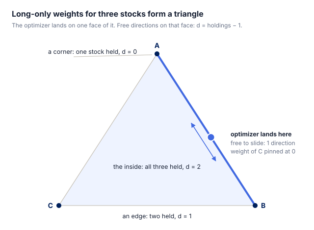
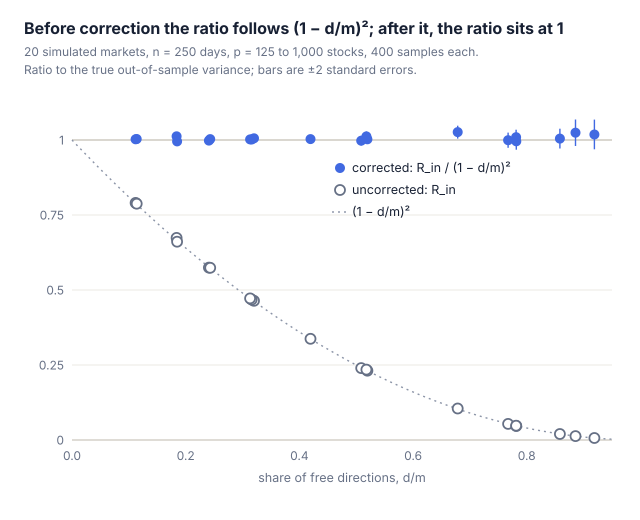
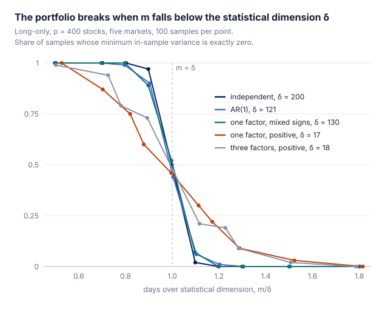
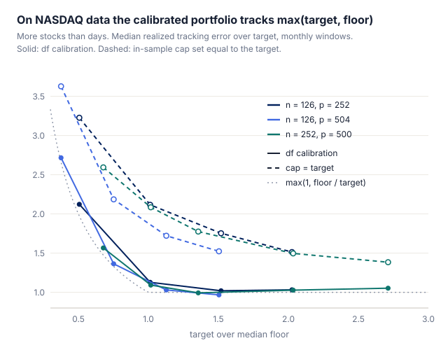

Editor's note

Three years ago, while working as a research assistant, I was doing high-dimensional constrained portfolio work in MATLAB and R. The code is in <a href="https://github.com/microfan1/CROWN">CROWN</a>, and my advisor's paper later came out in <a href="https://www.tandfonline.com/doi/full/10.1080/01621459.2025.2602832">JASA</a>. What I was reading at the time was a printout a senior student handed me: Fan Jianqing's <a href="https://www.taylorfrancis.com/books/mono/10.1201/9780429096280/statistical-foundations-data-science-jianqing-fan-runze-li-cun-hui-zhang-hui-zou">Statistical Foundations of Data Science</a>. Before graduating I also helped proofread its <a href="http://fj.tsxcfw.com/bookshow.asp?id=3230017">Chinese translation</a>.

Three years on, LLM agents are strong enough at mathematics and code that I no longer have to derive a conic program, run an interior-point solver, or compute a Sharpe ratio, and work like this needs no multi-GPU cluster. Yet I am still learning the same advanced statistics, so a question keeps nagging: can the strongest AI write a paper good enough for one of the top four statistics journals, from idea to final draft?

Taking this high-dimensional portfolio problem as the topic, I wrote my requirements out as a prompt and let Claude Opus 5.5 Max run in autoresearch mode. Within a day it produced a paper, presented here as a blog post. I rarely adjusted the agent's behaviour or decisions: the idea, the experiments, the paper and this blog post were all written by Claude. I only did a rough review and proofread, so I do not claim the contribution as mine — I am sharing it, and thinking out loud about it.

The study looks plausible, but I cannot vouch for whether it has real research or practical value. What bothers me more is something else: if a study like this can appear in a day, could one determined person submit to a top statistics journal every day, and would the review system buckle under the load? As human experts find it harder to keep up with AI-generated work, how to separate validity from contribution — and write a review that is actually competent, then decide acceptance — is what I am really curious about.

Fit a minimum-variance portfolio on a year of daily returns and the optimizer tells you how risky the portfolio is. That number is too low, often by a lot. In one of the examples below — 500 stocks, 250 days, short sales banned — the optimizer reports about one eighteenth of the variance the portfolio actually carries.

The reason is the same one that makes training error lower than test error. The covariance matrix is estimated from the same data the optimizer uses to pick the weights, and the optimizer is very good at finding combinations whose risk the sample happens to underestimate. Without constraints the size of this gap has been known for a long time. Real portfolios are constrained — no short sales, position limits, sector bounds, tracking-error budgets — and once a constraint binds, the classical formula no longer applies.

This post is about what replaces it. The answer fits in one line: count the holdings, not the assets.

# 1 Takeaways

- **Count the holdings, not the assets.** With n days of data, divide the in-sample variance by (1 − d/m)2, where m = n − 1 and d is the number of stocks held minus one. In general d is the dimension of the face of the constraint set on which the optimizer lands, and the optimizer reports it for free.
- **With fewer stocks than days, this is provably accurate** for every covariance matrix and every set of linear constraints, with an error that shrinks like 1/√m. In 20 simulated markets the corrected value is within 2.6% of the true variance on average; the uncorrected value is up to 150 times too low.
- **Counting all the assets overshoots.** The classical correction, which uses the number of stocks p instead of d, puts the risk 1.3 to 3.1 times too high at p/n = 0.5 and up to 18.6 times too high at p/n = 0.8. Once p ≥ n it is not defined at all.
- **With more stocks than days, one number decides whether the portfolio breaks.** The optimizer finds a portfolio with zero in-sample risk exactly when the statistical dimension of the constraint cone exceeds m. Below that line the correction still works.
- **For tracking-error mandates, the same idea sets the budget.** On NASDAQ data, capping the in-sample tracking error at the target overshoots it by 27% to 132% at the median; calibrating the cap with d brings this to 0% to 12%. With more stocks than days there is a floor that no budget can push below.

# 2 Why the optimizer's number is too low

Two things cause this.

First, the covariance matrix is estimated, and estimated badly. For 500 stocks it has 125,250 distinct entries; a year of daily data gives 250 × 500 = 125,000 numbers. Every entry carries real noise.

Second, the same data both choose the portfolio and grade it. Fix a portfolio in advance and its sample variance is an unbiased estimate of its true variance: sometimes high, sometimes low, right on average. The bias comes from choosing. The simplest version: take 500 stocks with exactly the same true variance, estimate each variance from 250 days, and pick the stock with the smallest estimate. In a quick simulation the winner's estimated variance averages 0.75 of its true value. No single estimate is wrong; the winner is just the stock whose noise happened to help.

A minimum-variance optimizer does this on a much larger scale. It does not only pick quiet stocks; it also builds hedges out of correlations that look strong in the sample. Two stocks whose sample correlation is 0.8 but whose true correlation is 0.3 look like a good long–short pair. Out of sample the hedge does not hedge.

Without constraints the damage is known precisely. The in-sample variance is too low by a factor of about 1 − p/n ([El Karoui, 2010](https://arxiv.org/abs/1211.2917)), and the variance you actually bear is too high by about 1/(1 − p/n), so the two differ by about (1 − p/n)−2. Dividing by that factor was proposed as a correction for risk forecasts ([Shepard, 2009](https://arxiv.org/abs/0908.2455)). At p/n = 0.4 the gap is a factor of 2.8; at p/n = 0.8 it is 25.

Constraints are known to help ([Jagannathan and Ma, 2003](https://www.nber.org/papers/w8922)), but the algebra behind the classical formula needs a closed-form solution, and with inequality constraints there is none. The standard workaround is the jackknife ([Basak, Jagannathan and Ma, 2009](https://doi.org/10.1287/mnsc.1090.1001)): refit the portfolio n times and see how far the refits scatter.

# 3 Count the face, not the assets

With three stocks and no short sales, every allowed portfolio is a point in a triangle. Wherever the optimizer lands, it sits on one face of that triangle: in the interior (all three held), on an edge (two held) or at a corner (one held). On that face the problem looks unconstrained. A stock that is not held has its weight pinned at zero; the others slide freely. The number of free directions is d = holdings − 1.

***Figure 1** The optimizer lands on an edge: two stocks are held, one direction is free, so d = 1.*

That suggests replacing the classical p − 1 free parameters by d:

**Rout ≈ Rin / (1 − d/m)2, with m = n − 1,**

where Rin is the in-sample variance the optimizer reports and Rout is the variance the portfolio really has. The rule extends to any linear constraints. With upper and lower bounds on each weight, d counts the weights strictly between their bounds, minus one; every extra constraint that binds, such as a sector limit at its cap, removes one more direction.

Back to the opening example: 500 stocks with AR(1) correlations, 250 days, short sales banned. The optimizer holds about 192 stocks, so d/m ≈ 0.77. The in-sample variance is 1/18.6 of the truth, and dividing by (1 − 0.77)2 recovers the truth to within 0.1% on average. Counted in assets the problem looks hopeless, with p/n = 2; counted in free directions it is not.

The obvious objection: d is chosen by the data. We just saw that choosing creates bias, so why should a chosen number correct it? The lasso has the same structure. Which coefficients are non-zero is decided by the data, and yet the lasso's degrees of freedom equal the number of non-zero coefficients ([Tibshirani and Taylor, 2012](https://doi.org/10.1214/12-AOS1003)). The constrained portfolio is a least-squares problem in disguise, and d is exactly its degrees of freedom: near the solution, the face does not change under small perturbations of the data, and for Gaussian returns that holds with probability one.

What was missing was a proof that this works where portfolios live: random returns rather than a fixed design, and a hard constraint rather than a penalty. [Bellec (2023)](https://arxiv.org/abs/2008.11840) proved the (1 − df/n)−2 estimate for convex penalties that take finite values, which rules constraints out. We reach constraints as the limit of steeper and steeper penalties. Two results come out:

- **A finite-sample bound.** For p < n, the expected relative error of the corrected estimate is at most C/√m, where C depends only on p/n — not on the covariance matrix, not on the constraints, and not on whether the constraints bind in the population.
- **An exact identity.** It says why the correction works: the bias of Rin is of first order, about 2d/m in relative terms, and the bias of the corrected estimate is of second order.

# 4 How accurate is it?

Figure 2 covers 20 simulated markets: independent stocks, AR(1) correlations, and one- and three-factor markets with all-positive or mixed-sign loadings. Before correction, the ratio of in-sample to true variance falls almost exactly on the curve (1 − d/m)2, whatever the market: the size of the bias depends on d/m and on nothing else. After correction every point sits at 1, including the one at d/m = 0.92, where the in-sample variance was 150 times too low.

***Figure 2** Open circles: in-sample over true variance. Filled: corrected over true variance. Every market, before and after.*

Using p instead of d is not a harmless approximation:

| Market | p/n = 0.2 | p/n = 0.5 | p/n = 0.8 |
| --- | --- | --- | --- |
| Independent stocks | 1.01 / 0.99 | 1.35 / 1.02 | 4.26 / 1.02 |
| AR(1) | 1.10 / 1.00 | 1.85 / 1.00 | 7.88 / 1.02 |
| One factor, mixed signs | 1.13 / 1.00 | 1.87 / 1.01 | 7.04 / 0.99 |
| One factor, all positive | 1.36 / 1.00 | 3.13 / 1.00 | 18.60 / 1.00 |

*Mean of estimate over true variance: classical correction (counts p) / ours (counts d). n = 250, 400 samples per cell.*

The two agree only when almost every stock is held, as for independent stocks at p/n = 0.2. The worst case is the market that looks most like a real equity market — every stock loads positively on the market factor — where the optimizer holds only 17% to 35% of the stocks. There the classical correction is further from the truth than no correction at all.

The 1/√m rate is visible too. In four markets with m from 50 to 400, √m times the mean relative error stays between 0.57 and 1.27.

These are averages. In a single sample the corrected value still scatters: its standard deviation across samples grows from 0.10 at small d/m to 0.49 at d/m = 0.92. The bound in the theorem is a bound on the expected error, not a prediction interval.

# 5 More stocks than days

With n days of data, demeaned returns span only m = n − 1 directions. With more stocks than that, some portfolios do not move at all in the sample, and an unconstrained optimizer reports zero risk. Constraints may or may not rule those portfolios out. When they do not, the in-sample variance is exactly zero, the true variance is not, and no correction can help.

Whether this happens is decided by one number: the statistical dimension δ of the constraint cone after whitening by the covariance, a measure of how large the constraint set looks to random noise ([Amelunxen et al., 2014](https://arxiv.org/abs/1303.6672)). If δ is above m, zero in-sample risk is almost certain; if δ is below m, it almost never happens; the switch takes place within a window of order √δ.

***Figure 3** δ ranges from 17 to 199 across the five markets, but all five curves cross 1/2 at m/δ between 0.96 and 1.00.*

Three markets make it concrete:

- **Independent stocks, long-only.** δ = p/2, so the portfolio breaks at p = 2m. This is the threshold that [Kondor, Papp and Caccioli (2017)](https://arxiv.org/abs/1612.07067) found with the replica method; their equations also imply our correction for this case, though they did not state it. Up to the threshold the long-only portfolio's true variance stays within a factor π of the best possible, while the unconstrained portfolio blows up at p = m.
- **AR(1) correlations.** δ ≈ 0.30p, so the threshold is at p ≈ 3.3m.
- **One factor, all loadings positive.** δ grows only like log p. The market factor cannot be hedged without short positions, so the long-only portfolio essentially never breaks.

When loadings take both signs, the factor can be hedged inside the long-only set and δ grows in proportion to p again. The NASDAQ data show exactly this. With quarterly windows the long-only portfolio reported zero risk in 3%, 19% and 28% of windows for 500, 1,000 and 1,455 stocks — all of them windows ending by early March 2020, in the calm period when many stocks had market loadings near zero or below it.

Below the threshold the correction keeps working. The convex Gaussian min–max theorem (see [Thrampoulidis, Abbasi and Hassibi, 2018](https://arxiv.org/abs/1601.06233)) gives the limits of both variances, without assuming that the unconstrained optimum satisfies the constraints. In that limit the correction is exact, and it carries over to the observed d at a rate of (log m / m)1/4.

# 6 Tracking-error budgets

An active manager maximizes an alpha signal subject to a cap on tracking error against a benchmark. Practitioners know that realized tracking error comes out above the ex-ante number — by 1.3 to 1.4 times in backtests with commercial risk models ([Saxena and Stubbs, 2012](https://scinapse.io/papers/2068160108)) — and add a buffer to the ex-ante estimate ([De Nard, Ledoit and Wolf, 2025](https://econ.uzh.ch/dam/jcr:8f7e20cf-e9a7-4fde-87cb-aef82de26404/jpm_2025.pdf)).

The same correction says how large the buffer should be: choose the in-sample cap so that TEin / (1 − d/m) equals the target, where d is the face dimension of the tracking-error portfolio. Tracking error is a standard deviation, so the factor is not squared.

| Days n | Stocks p | Target | d/m | Cap = target | Calibrated |
| --- | --- | --- | --- | --- | --- |
| 252 | 50 | 2% | 0.19 | 1.38 | 1.12 |
| 252 | 100 | 2% | 0.37 | 1.68 | 1.11 |
| 252 | 200 | 2% | 0.67 | 2.08 | 1.09 |
| 252 | 200 | 6% | 0.37 | 1.35 | 1.00 |
| 126 | 100 | 2% | 0.72 | 2.32 | 1.06 |

*NASDAQ, fewer stocks than days: median over monthly windows of realized tracking error over target. Equal-weight benchmark, momentum signal; d/m at the calibrated cap.*

A constant buffer could not do this. Across settings the naive cap overshoots by a factor between 1.27 and 2.32, because d/m varies; the calibrated cap stays between 1.00 and 1.12.

With more stocks than days, something new appears: a floor. As the in-sample budget shrinks to zero, the portfolio converges to one that replicates the benchmark exactly in sample. Under long-only constraints that portfolio holds exactly n stocks — it did in all 220 simulated cases. Its realized tracking error is positive, so shrinking the budget cannot push realized tracking error below that floor. In-sample numbers cannot see the floor either: at the floor the in-sample tracking error is 0 and d = m, so TEin / (1 − d/m) is 0/0. A practical warning sign is d/m > 0.85 at the calibrated cap; on NASDAQ it flagged 90% to 98% of the windows whose target was below the floor.

***Figure 4** The calibrated portfolio lands near max(target, floor); capping in-sample tracking error at the target overshoots everywhere.*

Where the floor lies below the target in most windows, the calibrated portfolio realizes 0.94 to 1.05 times the target, against 1.38 to 1.78 for the naive cap. Below the floor it realizes 1.02 to 1.07 times the floor, which is about as good as it gets. The floors are not small: medians of 5.4% and 7.3% a year with quarterly windows, 3.0% with one-year windows and 500 stocks, and 1.7% among the 500 least volatile stocks — well inside common mandate ranges.

# 7 What it does not fix

- **It does not raise the Sharpe ratio.** The weights are the same; the correction changes what you believe about their risk. Scaling a portfolio to a volatility target with an honest number does not change its Sharpe ratio either. It makes realized volatility land where you aimed.
- **A common daily shock.** If all stocks share a random scale each day (elliptical returns, volatility clustering), the formula comes out 7.5% to 38% too low in our simulations. Refitted leave-one-out — the jackknife — stays between 0.95 and 1.07 there, so report both.
- **Drift.** On NASDAQ the corrected minimum-variance forecast is still 1.1 to 1.5 times too low against an equal-weight reference. A split-sample forecast, which has no optimization bias at all, is also too low, by 1.02 to 1.41 times: the covariance moves between the estimation window and the holding period, and nothing computed inside one window can see that.
- **Factor risk models.** Most institutions do not optimize on the sample covariance. The theory covers the sample covariance, fixed ridge shrinkage and, as a proposal, exponential weights. What plays the role of d for a portfolio built on a factor-model or nodewise estimate is open.
- **The data.** The NASDAQ panel (1,455 stocks, January 2018 to May 2023, from [skfolio-datasets](https://github.com/skfolio/skfolio-datasets)) contains survivors only and is distributed as test data. The empirical part illustrates the method; it does not evaluate these stocks. The theory assumes Gaussian, independent returns.

# 8 How to use it

1. Solve the portfolio problem exactly, so that d is an exact count. Near d/m = 0.9, one miscounted holding moves the corrected estimate by several percent.
2. Report Rin / (1 − d/m)2 together with d/m. When d/m is close to 1, the in-sample number carries almost no information.
3. For tracking-error mandates, set the in-sample cap so that TEin / (1 − d/m) equals the target, and treat d/m > 0.85 as a sign that the target is at or below the floor.
4. Where you can afford it, also report the refitted leave-one-out estimate and a split-sample forecast, as checks against heavy tails and drift.

# References

1\. Kondor, I., Papp, G., and Caccioli, F. (2017). Analytic solution to variance optimization with no short positions. Journal of Statistical Mechanics. arXiv:1612.07067. [https://arxiv.org/abs/1612.07067](https://arxiv.org/abs/1612.07067)

2\. El Karoui, N. (2010). High-dimensionality effects in the Markowitz problem and other quadratic programs with linear constraints: Risk underestimation. The Annals of Statistics. arXiv:1211.2917. [https://arxiv.org/abs/1211.2917](https://arxiv.org/abs/1211.2917)

3\. Shepard, P. G. (2009). Second Order Risk. arXiv:0908.2455. [https://arxiv.org/abs/0908.2455](https://arxiv.org/abs/0908.2455)

4\. Jagannathan, R., and Ma, T. (2003). Risk Reduction in Large Portfolios: Why Imposing the Wrong Constraints Helps. The Journal of Finance. NBER Working Paper 8922. [https://www.nber.org/papers/w8922](https://www.nber.org/papers/w8922)

5\. Basak, G. K., Jagannathan, R., and Ma, T. (2009). Jackknife Estimator for Tracking Error Variance of Optimal Portfolios. Management Science. [https://doi.org/10.1287/mnsc.1090.1001](https://doi.org/10.1287/mnsc.1090.1001)

6\. Tibshirani, R. J., and Taylor, J. (2012). Degrees of freedom in lasso problems. The Annals of Statistics. [https://doi.org/10.1214/12-AOS1003](https://doi.org/10.1214/12-AOS1003)

7\. Bellec, P. C. (2023). Out-of-sample error estimation for M-estimators with convex penalty. Information and Inference. arXiv:2008.11840. [https://arxiv.org/abs/2008.11840](https://arxiv.org/abs/2008.11840)

8\. Amelunxen, D., Lotz, M., McCoy, M. B., and Tropp, J. A. (2014). Living on the edge: Phase transitions in convex programs with random data. Information and Inference. arXiv:1303.6672. [https://arxiv.org/abs/1303.6672](https://arxiv.org/abs/1303.6672)

9\. Thrampoulidis, C., Abbasi, E., and Hassibi, B. (2018). Precise error analysis of regularized M-estimators in high dimensions. IEEE Transactions on Information Theory. arXiv:1601.06233. [https://arxiv.org/abs/1601.06233](https://arxiv.org/abs/1601.06233)

10\. Saxena, A., and Stubbs, R. A. (2012). An Empirical Case Study of Factor Alignment Problems Using the USER Model. The Journal of Investing. [https://scinapse.io/papers/2068160108](https://scinapse.io/papers/2068160108)

11\. De Nard, G., Ledoit, O., and Wolf, M. (2025). Improved Tracking-Error Management for Active and Passive Investing. The Journal of Portfolio Management. [https://econ.uzh.ch/dam/jcr:8f7e20cf-e9a7-4fde-87cb-aef82de26404/jpm_2025.pdf](https://econ.uzh.ch/dam/jcr:8f7e20cf-e9a7-4fde-87cb-aef82de26404/jpm_2025.pdf)

12\. skfolio-datasets: datasets distributed with the skfolio library (NASDAQ daily prices). [https://github.com/skfolio/skfolio-datasets](https://github.com/skfolio/skfolio-datasets)
