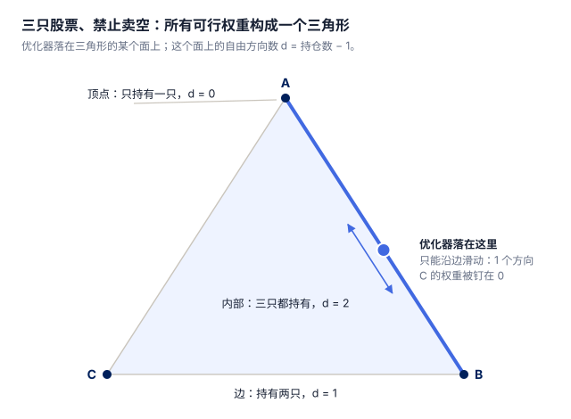
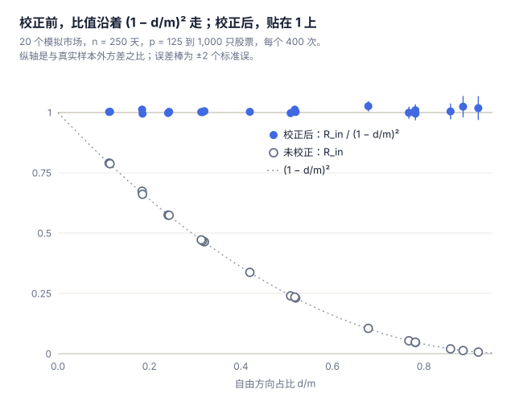
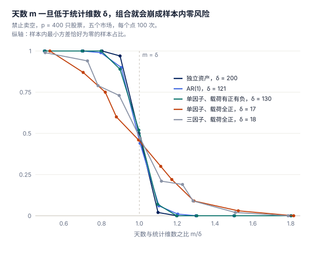
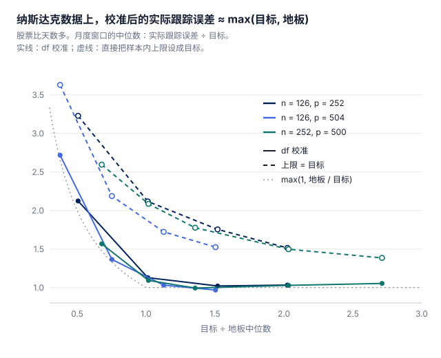

用一年的日收益率算一个最小方差组合，优化器会顺便告诉你这个组合的风险有多大。这个数是偏低的，而且常常低得离谱。后面有个例子：500 只股票、250 天数据、禁止卖空，优化器报出来的方差只有组合实际方差的约 1/18。

原因和"训练误差总比测试误差好看"是一回事。协方差矩阵是用数据估出来的，优化器又用同一份数据去挑权重，它特别擅长找到那些"在这份样本里风险恰好被低估"的组合。不加约束时，这个差距有多大早就算清楚了。可实际的组合都有约束：禁止卖空、单只上限、行业比例、跟踪误差预算。约束一旦顶住，经典公式就不再适用。

这篇讲的是用什么来代替它。答案一句话：数持仓，不数资产。

# 1 结论

- **数持仓，不数资产。** 有 n 天数据时，把样本内方差除以 (1 − d/m)2，其中 m = n − 1，d 是持仓数减一。一般地，d 是优化器落在约束集上那个"面"的维数，优化器算完就能直接读出来。
- **股票比天数少时，这个校正可以严格证明是准的**，对任意协方差、任意线性约束都成立，误差按 1/√m 缩小。在 20 个模拟市场里，校正后平均与真实方差相差不超过 2.6%；不校正最多低估 150 倍。
- **按资产数校正会矫枉过正。** 经典校正用股票数 p 而不是 d：p/n = 0.5 时把风险高估 1.3 到 3.1 倍，p/n = 0.8 时最多高估 18.6 倍；p ≥ n 时公式直接失去定义。
- **股票比天数多时，一个数决定组合会不会崩。** 当约束锥的统计维数超过 m，优化器就会找到一个样本内风险为零的组合。低于这条线时，校正依然有效。
- **跟踪误差预算也能这样定。** 纳斯达克数据上，直接把样本内跟踪误差上限设成目标，中位数超标 27% 到 132%；用 d 校准后只超 0% 到 12%。股票比天数多时，还存在一个预算定得再紧也压不下去的"地板"。

# 2 优化器报的数为什么偏低

需要两件事同时发生。

第一，协方差矩阵是估出来的，而且估不准。500 只股票的协方差矩阵有 125,250 个不同的元素，一年日数据只有 250 × 500 = 125,000 个数。每个元素都带着不小的噪声。

第二，同一份数据既用来挑组合，又用来给组合打分。如果组合是事先定好的，它的样本方差就是真实方差的无偏估计：有时高、有时低，平均下来是对的。偏差来自"挑"。举个最简单的例子：500 只股票的真实方差完全相同，用 250 天数据分别估方差，然后挑出估计值最小的那只。我简单模拟了一下，被挑中那只的估计方差平均只有真实值的 0.75。每个估计本身都没错，只是被挑中的恰好是噪声帮了忙的那一只。

最小方差优化器把这件事放大了很多倍。它不只挑波动小的股票，还会利用样本里"看起来很强"的相关性去构造对冲。两只股票样本相关系数 0.8、真实只有 0.3，看起来是一对很好的多空组合；到了样本外，这个对冲根本对冲不住。

不加约束时，偏差的大小是精确知道的。样本内方差被压低约 1 − p/n 倍（[El Karoui, 2010](https://arxiv.org/abs/1211.2917)），你实际承担的方差被抬高约 1/(1 − p/n) 倍，两者相差约 (1 − p/n)−2。用这个因子去修正风险预测，早就有人提过（[Shepard, 2009](https://arxiv.org/abs/0908.2455)）。p/n = 0.4 时差 2.8 倍；p/n = 0.8 时差 25 倍。

大家也早就知道约束有帮助（[Jagannathan and Ma, 2003](https://www.nber.org/papers/w8922)）。可经典公式背后的推导需要封闭解，有了不等式约束就没有封闭解。以往的办法是用 jackknife，把组合重新拟合 n 次（[Basak, Jagannathan and Ma, 2009](https://doi.org/10.1287/mnsc.1090.1001)）。

# 3 数面，不数资产

三只股票、禁止卖空时，所有允许的组合构成一个三角形。优化器无论落在哪里，都在三角形的某个"面"上：内部（三只都持有）、某条边（持有两只）或某个顶点（只持有一只）。在这个面上，问题看起来就是没有约束的：没持有的股票权重被钉在 0，其余的可以自由滑动。自由方向的个数 d = 持仓数 − 1。

***图 1** 优化器落在一条边上：持有两只股票，只有一个自由方向，所以 d = 1。*

于是很自然地，把经典公式里的 p − 1 个自由参数换成 d：

**Rout ≈ Rin / (1 − d/m)2，其中 m = n − 1。**

Rin 是优化器报出的样本内方差，Rout 是组合真实的方差。这个规则可以推广到任意线性约束：如果每只股票的权重有上下限，d 就是严格夹在上下限之间的权重个数减一；每多一个顶格的约束（比如某个行业比例正好顶到上限），就再少一个自由方向。

回到开头的例子：500 只股票、AR(1) 相关、250 天、禁止卖空。优化器持有约 192 只，d/m ≈ 0.77。样本内方差只有真实值的 1/18.6，除以 (1 − 0.77)2 之后，平均与真实值相差不到 0.1%。按资产数算，p/n = 2，问题看起来没救了；按自由方向算，并非如此。

一个显然的疑问：d 本身是数据挑出来的。前面刚说过"挑"会制造偏差，凭什么用一个挑出来的数去做校正？lasso 有一模一样的结构：哪些系数非零是数据决定的，但 lasso 的自由度恰好就等于非零系数的个数（[Tibshirani and Taylor, 2012](https://doi.org/10.1214/12-AOS1003)）。带约束的组合本质上是一个最小二乘问题，d 正是它的自由度：在解的附近，数据稍微扰动，落点所在的面不会变；对高斯收益率，这一点以概率 1 成立。

此前缺的，是在组合真正所处的设定下证明这件事：收益率是随机的，而不是固定设计；约束是硬约束，而不是惩罚项。[Bellec (2023)](https://arxiv.org/abs/2008.11840) 对取有限值的凸惩罚证明了 (1 − df/n)−2 这个估计，约束恰好被排除在外。我们把约束看成越来越陡的惩罚的极限，得到两个结果：

- **有限样本的误差界。** p < n 时，校正后估计的相对误差，期望不超过 C/√m，其中 C 只依赖 p/n：不依赖协方差矩阵，不依赖约束，也不管约束在总体上是否顶住。
- **一个精确恒等式。** 它解释了校正为什么有效：Rin 的偏差是一阶的，相对大小约 2d/m；校正后的偏差是二阶的。

# 4 准不准？

图 2 是 20 个模拟市场：独立股票、AR(1) 相关，以及载荷全正或有正有负的单因子、三因子市场。校正前，样本内与真实方差之比几乎正好落在 (1 − d/m)2 这条曲线上，不论是哪个市场：偏差有多大，只取决于 d/m。校正后，所有点都贴在 1 上，包括 d/m = 0.92、样本内方差低估了 150 倍的那个点。

***图 2** 空心圆：样本内 ÷ 真实方差。实心：校正后 ÷ 真实方差。所有市场，校正前后。*

用 p 代替 d 并不是无伤大雅的近似：

| 市场 | p/n = 0.2 | p/n = 0.5 | p/n = 0.8 |
| --- | --- | --- | --- |
| 独立股票 | 1.01 / 0.99 | 1.35 / 1.02 | 4.26 / 1.02 |
| AR(1) | 1.10 / 1.00 | 1.85 / 1.00 | 7.88 / 1.02 |
| 单因子，载荷有正有负 | 1.13 / 1.00 | 1.87 / 1.01 | 7.04 / 0.99 |
| 单因子，载荷全正 | 1.36 / 1.00 | 3.13 / 1.00 | 18.60 / 1.00 |

*估计值 ÷ 真实方差的均值：经典校正（数 p）/ 本文（数 d）。n = 250，每格 400 次。*

两者只在几乎所有股票都被持有时一致，比如独立股票、p/n = 0.2。最糟的恰恰是最像真实股市的情形：所有股票对市场因子的载荷都为正，优化器只持有 17% 到 35% 的股票。在这个市场里，经典校正离真相比完全不校正还远。

1/√m 的速率也看得出来。在四个市场里，m 从 50 到 400，√m 乘以平均相对误差一直稳定在 0.57 到 1.27 之间。

这些都是平均值。单次样本里，校正值仍有波动：它在不同样本间的标准差，从 d/m 小时的 0.10 增长到 d/m = 0.92 时的 0.49。定理给的是期望误差的界，不是预测区间。

# 5 股票比天数多

n 天的数据去掉均值后，只能张成 m = n − 1 个方向。股票数超过这个数时，有些组合在样本里完全不动，不加约束的优化器就会报告"风险为零"。约束可能排除这些组合，也可能排除不了。排除不了时，样本内方差恰好是零，真实方差却不是，任何校正都救不回来。

会不会发生，由一个数决定：协方差白化之后约束锥的统计维数 δ，它衡量约束集在随机噪声"眼里"有多大（[Amelunxen et al., 2014](https://arxiv.org/abs/1303.6672)）。δ 高于 m 时，几乎一定出现零风险；δ 低于 m 时，几乎不会出现；切换发生在宽度约 √δ 的窗口里。

***图 3** 五个市场的 δ 从 17 到 199，相差十几倍，但五条曲线都在 m/δ = 0.96 到 1.00 之间穿过 1/2。*

三个市场让它更具体：

- **独立股票、禁止卖空。** δ = p/2，组合在 p = 2m 时崩溃。这正是 [Kondor, Papp and Caccioli (2017)](https://arxiv.org/abs/1612.07067) 用 replica 方法找到的阈值；他们的方程其实也隐含了这种情形下的校正公式，只是没有写出来。直到阈值之前，禁止卖空组合的真实方差都不超过理想值的 π 倍，而不加约束的组合在 p = m 时就发散了。
- **AR(1) 相关。** δ ≈ 0.30p，阈值在 p ≈ 3.3m。
- **单因子、载荷全正。** δ 只按 log p 增长。不卖空就对冲不掉市场因子，所以禁止卖空的组合几乎永远不会崩。

载荷有正有负时，市场因子可以在禁止卖空的范围内被对冲，δ 又重新和 p 同阶。纳斯达克数据恰好显示了这一点：用季度窗口，500、1,000、1,455 只股票时，分别有 3%、19%、28% 的窗口出现了零风险组合，而且全部是 2020 年 3 月初之前结束的窗口，也就是那段平静期，当时很多股票的市场载荷接近零甚至为负。

阈值以下，校正依然有效。借助凸高斯极小极大定理（参见 [Thrampoulidis, Abbasi and Hassibi, 2018](https://arxiv.org/abs/1601.06233)），可以算出两种方差的极限，而且不需要假设不加约束的最优组合满足约束。在这个极限里，校正是精确的；它以 (log m / m)1/4 的速率传递到实际观测的 d 上。

# 6 跟踪误差预算

主动管理的基金经理在跟踪误差上限的约束下，最大化 alpha 信号。业内都知道，事后实际跟踪误差会高于事前估计：用商业风险模型回测，高出 1.3 到 1.4 倍（[Saxena and Stubbs, 2012](https://scinapse.io/papers/2068160108)），所以经理们会给事前估计留一个缓冲（[De Nard, Ledoit and Wolf, 2025](https://econ.uzh.ch/dam/jcr:8f7e20cf-e9a7-4fde-87cb-aef82de26404/jpm_2025.pdf)）。

同一个校正告诉你缓冲该留多大：选样本内上限，使 TEin / (1 − d/m) 等于目标，其中 d 是跟踪误差组合所在面的维数。跟踪误差是标准差，所以这里不平方。

| 天数 n | 股票 p | 目标 | d/m | 上限 = 目标 | 校准后 |
| --- | --- | --- | --- | --- | --- |
| 252 | 50 | 2% | 0.19 | 1.38 | 1.12 |
| 252 | 100 | 2% | 0.37 | 1.68 | 1.11 |
| 252 | 200 | 2% | 0.67 | 2.08 | 1.09 |
| 252 | 200 | 6% | 0.37 | 1.35 | 1.00 |
| 126 | 100 | 2% | 0.72 | 2.32 | 1.06 |

*纳斯达克，股票比天数少：月度窗口上"实际跟踪误差 ÷ 目标"的中位数。基准为等权组合，信号为动量；d/m 取校准后的值。*

固定的缓冲做不到这一点。不同设定下，直接设上限会超标 1.27 到 2.32 倍，因为 d/m 在变；校准后则稳定在 1.00 到 1.12 倍。

股票比天数多时，会出现一个新东西：地板。把样本内预算一路收紧到零，组合会收敛到一个在样本内完全复制基准的组合；在禁止卖空约束下，它恰好持有 n 只股票，220 个模拟样本无一例外。它的真实跟踪误差是正的，所以预算收得再紧，实际跟踪误差也压不到地板以下。样本内的数字还看不见这个地板：在地板处，样本内跟踪误差是 0，d = m，TEin / (1 − d/m) 是 0/0。实用的警报是：校准后的 d/m > 0.85。在纳斯达克数据上，它识别出了 90% 到 98% 目标低于地板的窗口。

***图 4** 校准后的组合落在 max(目标, 地板) 附近；直接把样本内上限设成目标，处处超标。*

地板在多数窗口低于目标时，校准后的实际跟踪误差是目标的 0.94 到 1.05 倍，直接设上限则是 1.38 到 1.78 倍。目标低于地板时，校准后是地板的 1.02 到 1.07 倍，基本已经是能做到的最好。地板也不小：季度窗口的中位数是每年 5.4% 和 7.3%，一年窗口、500 只股票时是 3.0%，波动最低的 500 只股票里是 1.7%，都落在常见的跟踪误差约定范围内。

# 7 它解决不了什么

- **它不会提高夏普比率。** 权重没变，变的只是你对风险的认识。用诚实的风险数字把组合缩放到目标波动率，也不会改变夏普比率，只是让实际波动落在你瞄准的地方。
- **全市场共同的冲击。** 如果所有股票每天共享一个随机的波动尺度（椭圆分布、波动率聚集），这个公式在我们的模拟里会偏低 7.5% 到 38%。重新拟合的留一法（也就是 jackknife）在同样的情形下稳定在 0.95 到 1.07，所以建议两个都报告。
- **漂移。** 纳斯达克上，以等权组合为参照，校正后的最小方差预测仍然偏低 1.1 到 1.5 倍。完全没有优化偏差的 split-sample 预测同样偏低 1.02 到 1.41 倍：协方差在估计窗口和持有期之间变了，单个窗口里算出来的任何东西都看不见这一点。
- **因子风险模型。** 大多数机构并不直接用样本协方差去优化。理论覆盖的是样本协方差、固定强度的岭收缩，以及作为提议的指数加权。如果组合是用因子模型或节点回归的估计构造的，什么量扮演 d 的角色，目前还是开放问题。
- **数据本身。** 纳斯达克面板（1,455 只股票，2018 年 1 月到 2023 年 5 月，来自 [skfolio-datasets](https://github.com/skfolio/skfolio-datasets)）只包含存续股票，数据方声明仅供测试。实证部分是在演示方法，不是在评价这些股票。理论假设收益率服从独立的高斯分布。

# 8 怎么用

1. 精确求解组合问题，让 d 是一个准确的计数。在 d/m = 0.9 附近，数错一个持仓，校正值就会差好几个百分点。
2. 报告 Rin / (1 − d/m)2，同时报告 d/m。d/m 接近 1 时，样本内的数字几乎不包含信息。
3. 有跟踪误差约定时，选样本内上限使 TEin / (1 − d/m) 等于目标；校准后 d/m > 0.85，就说明目标可能已经低于地板。
4. 算得起的话，再报告重新拟合的留一法估计和 split-sample 预测，用来检查厚尾和漂移。

# 参考文献

1\. Kondor, I., Papp, G., and Caccioli, F. (2017). Analytic solution to variance optimization with no short positions. Journal of Statistical Mechanics. arXiv:1612.07067. [https://arxiv.org/abs/1612.07067](https://arxiv.org/abs/1612.07067)

2\. El Karoui, N. (2010). High-dimensionality effects in the Markowitz problem and other quadratic programs with linear constraints: Risk underestimation. The Annals of Statistics. arXiv:1211.2917. [https://arxiv.org/abs/1211.2917](https://arxiv.org/abs/1211.2917)

3\. Shepard, P. G. (2009). Second Order Risk. arXiv:0908.2455. [https://arxiv.org/abs/0908.2455](https://arxiv.org/abs/0908.2455)

4\. Jagannathan, R., and Ma, T. (2003). Risk Reduction in Large Portfolios: Why Imposing the Wrong Constraints Helps. The Journal of Finance. NBER Working Paper 8922. [https://www.nber.org/papers/w8922](https://www.nber.org/papers/w8922)

5\. Basak, G. K., Jagannathan, R., and Ma, T. (2009). Jackknife Estimator for Tracking Error Variance of Optimal Portfolios. Management Science. [https://doi.org/10.1287/mnsc.1090.1001](https://doi.org/10.1287/mnsc.1090.1001)

6\. Tibshirani, R. J., and Taylor, J. (2012). Degrees of freedom in lasso problems. The Annals of Statistics. [https://doi.org/10.1214/12-AOS1003](https://doi.org/10.1214/12-AOS1003)

7\. Bellec, P. C. (2023). Out-of-sample error estimation for M-estimators with convex penalty. Information and Inference. arXiv:2008.11840. [https://arxiv.org/abs/2008.11840](https://arxiv.org/abs/2008.11840)

8\. Amelunxen, D., Lotz, M., McCoy, M. B., and Tropp, J. A. (2014). Living on the edge: Phase transitions in convex programs with random data. Information and Inference. arXiv:1303.6672. [https://arxiv.org/abs/1303.6672](https://arxiv.org/abs/1303.6672)

9\. Thrampoulidis, C., Abbasi, E., and Hassibi, B. (2018). Precise error analysis of regularized M-estimators in high dimensions. IEEE Transactions on Information Theory. arXiv:1601.06233. [https://arxiv.org/abs/1601.06233](https://arxiv.org/abs/1601.06233)

10\. Saxena, A., and Stubbs, R. A. (2012). An Empirical Case Study of Factor Alignment Problems Using the USER Model. The Journal of Investing. [https://scinapse.io/papers/2068160108](https://scinapse.io/papers/2068160108)

11\. De Nard, G., Ledoit, O., and Wolf, M. (2025). Improved Tracking-Error Management for Active and Passive Investing. The Journal of Portfolio Management. [https://econ.uzh.ch/dam/jcr:8f7e20cf-e9a7-4fde-87cb-aef82de26404/jpm_2025.pdf](https://econ.uzh.ch/dam/jcr:8f7e20cf-e9a7-4fde-87cb-aef82de26404/jpm_2025.pdf)

12\. skfolio-datasets：skfolio 库附带的数据集（纳斯达克日度价格）。[https://github.com/skfolio/skfolio-datasets](https://github.com/skfolio/skfolio-datasets)
