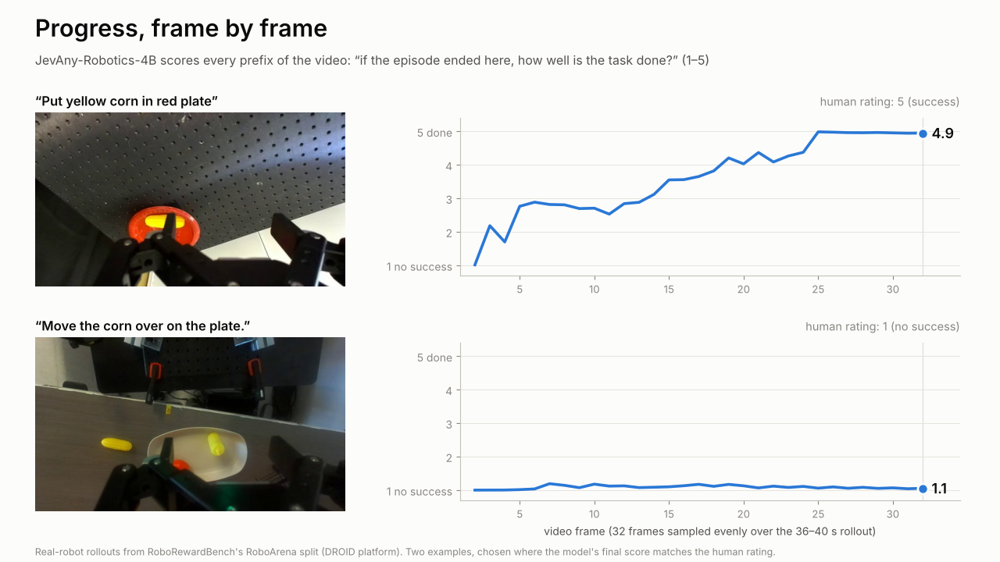
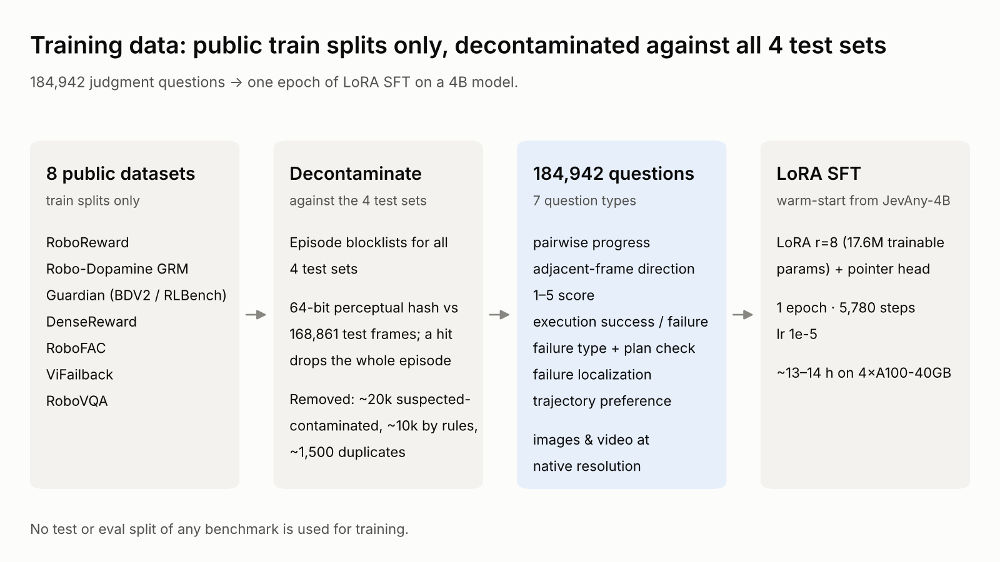
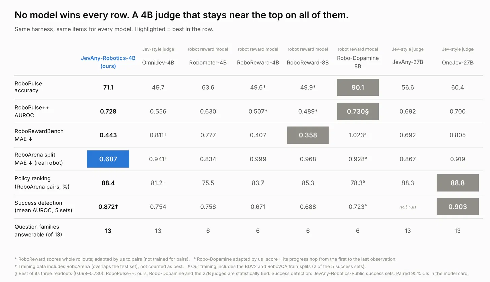
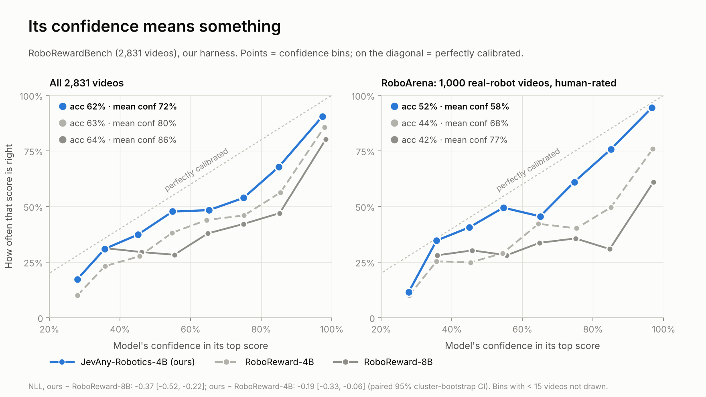

决策模型（Jev 式、System One）回答问题的方式和生成式模型不同：给它一个状态和一组选项，它一次前向就给出每个选项的概率，不生成文本。我们想知道，只用公开数据和我们的训练方法，这样一个 4B 的决策模型在机器人操作的评判上能做到什么程度。

# 结论

1. **公开数据就能把 4B 决策模型训得很强。** 在 RoboPulse、RoboRewardBench 和人工打分的真机 rollout（RoboArena）上，它超过我们测过的所有多模态 Jev 式模型，包括 27B 的；RoboPulse++ 和给策略排序上与 27B 打平。专用的机器人奖励模型在各自的主场仍然更强：Robo-Dopamine 在细粒度进度判断上（RoboPulse 90% 对 71%），RoboReward 在 1–5 打分上（MAE 0.358 对 0.443）。
2. **它的概率可信，也快。** RoboRewardBench 上它的 NLL 是所有测过的模型里最低的（1.02，RoboReward-8B 1.39）；单张 A100 上每次判断 185 ms，Robo-Dopamine-8B 316 ms，27B judge 用两张卡也要 732–838 ms。
3. **短板清楚，而且看起来能补。** 细粒度进度、RoboRewardBench 的合成题、多相机视角是它最弱的地方。加 2.2 万道新真机题续训后，两相机进度的 AUROC 从 0.65 升到 0.77（置信区间刚好碰到 0），但单视角变差，整体差不多持平，所以发布版仍是第一版（v0.2）。

# 一个模型，回答一段 rollout 的所有问题

给它一段机器人 rollout 和一个问题，它对每个可能的答案给出概率。一段 rollout 上你会问的问题，它都能回答：

- **进度**：两个时刻之间，任务有没有往前推进？
- **整段打分**：任务完成得怎么样，1–5 分？
- **步骤成败**：这个子任务成功了吗？
- **失败类型**：拿错物体、放错位置、没抓住，还是根本没动？
- **计划检查**：动手之前，这个计划对不对，错在哪？
- **失败定位**：rollout 在哪一步出了错？
- **偏好**：两段 rollout 哪段更好？

在每一帧都问一次“任务完成到哪了”，就得到一条进度曲线（图 1）。成功的那段，玉米落到盘子上时分数升到 5；失败的那段，分数一直停在 1。

***图 1** 两段 RoboArena 真机 rollout（RoboRewardBench 的 RoboArena 子集，DROID 平台）的逐帧打分：对视频的每个前缀问“如果在这里结束，任务完成得怎么样（1–5）”，曲线是期望分。两段都选自模型最终分数和人工打分一致的例子。*

# 决策模型一次前向就给出所有选项的概率

每道题由状态（任务指令、图像或视频）和一个带类型的问题组成：是非题、多选题或 1–5 打分题，选项和判分标准都写在题里。模型把状态和所有选项一起编码，由 pointer head 在选项上打分，直接输出一个概率分布，不逐词生成。

这带来两个对机器人评判很有用的性质。一是选项再多也只算一次，延迟不随答案长度增长。二是输出本身就是概率，可以直接当奖励信号、拿来筛数据，或者按置信度决定什么时候交给人复核。

JevAny-Robotics-4B 从我们开源的 JevAny-Qwen3.5-4B-LoRA 热启动。后者在通用决策数据上训练过，底座是 Qwen3.5-4B。我们只训 LoRA（r = 8，共 1,760 万可训练参数）和 pointer head：一个 epoch、5,780 步、全局 batch 32、学习率 1e-5，在 4 张 A100-40GB 上约 13–14 小时。图像用原分辨率；视频先重采样成约 1–2 fps、8–32 帧的短片，再全部帧输入。

# 训练数据只来自公开数据集的 train split

我们想回答的问题是：不采新数据、不做人工标注，只把现有公开数据改写成决策题，能把一个 4B 模型训到什么程度。

来源是 RoboReward、Robo-Dopamine GRM、Guardian（BDV2 / RLBench）、DenseReward、RoboFAC、ViFailback 和 RoboVQA 的 train split，涵盖真机和仿真、图像和视频。每个来源原本的标签形式不同：整段 1–5 分、帧级进度、成败标签、失败类型、规划是否正确。我们把它们统一改写成 7 类题：成对进度、相邻帧方向、1–5 打分、执行成败、失败类型与规划检查、失败定位、轨迹偏好，共 184,942 道（图 2）。

***图 2** 训练数据的构造。只用各数据集的 train split，对 4 个测试集去重后改写成 7 类决策题，再做一个 epoch 的 LoRA SFT。*

去重分两步。第一步是 episode 级黑名单：凡是出现在 RoboPulse、RoboPulse++、RoboRewardBench 或 JevAny-Robotics-Public 测试集里的 episode，一律不用。第二步是帧级哈希：把训练帧和 168,861 张测试帧做 64 位感知哈希比对，命中一帧就丢掉整个 episode。两步加上规则过滤和查重，共去掉约 2 万道疑似污染的题、约 1 万道不合规则的题和约 1,500 道重复题。

需要说明的是，去重去掉的是同一个 episode，去不掉同一个场景和同一台机器人。RoboPulse 和 RoboRewardBench 与训练数据出自同一批公开数据集，所以测试题对我们来说并不是完全陌生的场景。对比里的专用奖励模型也是这样：RoboReward 在 RoboReward train 上训练，Robo-Dopamine 在 GRM 数据上训练。JevAny-Robotics-Public 的 5 个成败集合里有 2 个（BDV2、RoboVQA）的 train split 在我们的训练数据里，下文报这一项时会标出来。

训练集 JevAny-Robotics-Train-v0.2 还在确认部分来源的再发布许可，确认后公开。

# 公开数据能把 4B 训到哪里：超过其他多模态 Jev 类模型，专用模型仍守住自己的主场

我们把 8 个模型放进同一套 harness，题目和媒体完全相同。一边是支持多模态的 Jev 类决策模型：JevAny-27B、OneJev-27B、OmniJev-4B；另一边是专门为机器人训练的奖励模型：Robo-Dopamine-GRM-2.0-8B、RoboReward-8B / 4B、Robometer-4B（图 3）。

***图 3** 8 个模型在 7 项测试上的成绩。没有一个模型在所有行都赢；JevAny-Robotics-4B 在每一行都靠前。*

主要数字如下。

| 测试 | 指标 | 我们 4B | Robo-Dopamine-8B | RoboReward-8B | Robometer-4B | JevAny-27B | OneJev-27B |
| --- | --- | --- | --- | --- | --- | --- | --- |
| RoboPulse（1,800 对） | acc / AUROC | 71.1 / 0.806 | **90.1 / 0.953** | 49.9 / 0.499ᵃ | 63.6 / 0.700 | 56.6 / 0.627 | 60.4 / 0.651 |
| RoboPulse++（7,720 对） | AUROC | **0.728** | 0.717（去偏 0.730） | 0.489ᵃ | 0.630 | 0.692 | 0.700 |
| RoboRewardBench（2,831 段） | MAE ↓ | 0.443 | 1.023ᵇ | **0.358** | 0.777 | 0.692 | 0.805 |
| RoboArena 真机（1,000 段） | MAE ↓ | **0.687** | 0.928ᵇ | 0.968 | 0.834 | 0.867 | 0.919 |
| 策略排序（805 对） | 与人工一致 % | 88.4 | 78.3ᵇ | 85.3 | 75.5 | 88.3 | **88.8** |
| 成败判断（5 个集合） | 平均 AUROC | 0.872ᶜ | 0.723 | 0.688 | 0.756 | 未跑 | **0.903** |
| 能回答的题型（13 类） |  | 13 | 6 | 6 | 6 | 13 | 13 |

ᵃ RoboReward 只做整段打分，成对题是我们改造的。ᵇ Robo-Dopamine 用首帧到末帧的进度当分数，切点在 val 上拟合。ᶜ 5 个集合里有 2 个的 train split 在我们的训练数据里。改造规则见「实验细节」。RoboReward-4B 和 OmniJev-4B 的数字见模型卡。

和同类的多模态 Jev 类模型比，这个 4B 模型在 RoboPulse、RoboRewardBench 和 RoboArena 真机上都超过了参数量约为它 7 倍的 JevAny-27B 和 OneJev-27B。差距最大的是 RoboPulse：71.1% 对 56.6% 和 60.4%。RoboPulse++ 上我们的数字更高，但差距在置信区间内；策略排序上三者打平。成败判断和轨迹偏好上 OneJev-27B 仍然更好（AUROC 0.903 对 0.872，配对差 −0.031 \[−0.052, −0.012\]；偏好 0.836 对 0.771）。

和专用奖励模型比，结论取决于题目是不是它们的主场。

- **Robo-Dopamine 在细粒度进度上领先很多。** RoboPulse 90.1% 对 71.1%，配对差 −19.1 \[−21.3, −16.8\]。RoboPulse 的输入格式（3 视角 + 起止参考图）和它的训练格式完全一致。在连续步的 RoboPulse++ 上两者打平（配对差 +0.011 \[−0.026, +0.045\]）。
- **RoboReward 在 RoboRewardBench 整体上更好。** MAE 0.358 对 0.443，差距来自合成的 OXE 题，这正是它训练数据的构造方式。只看 1,000 段人工打分的真机视频（RoboArena），我们的误差是所有模型里最低的：0.687 对 RoboReward-8B 的 0.968，配对差 −0.281 \[−0.380, −0.190\]。
- **专用模型只答得了 6 类题。** 成败判断的 AUROC 我们比最好的奖励模型高 0.116；失败类型、规划检查和失败定位，它们本来就不回答。

我们的理解是，只用公开数据，一个小的决策模型可以做到什么题都答、每项都靠前；但在某一种固定格式上，专门为这种格式训练的模型仍然更强。

# 概率可信，速度也快

奖励信号不只要判得对，还要知道自己什么时候不确定。RoboRewardBench 的每段视频都要在 1–5 分上给出分布，我们比较了所有能输出这个分布的模型（图 4）。

***图 4** RoboRewardBench 上的可靠性图。横轴是模型对最高分选项的置信度，纵轴是实际命中率。RoboReward 在真机视频上明显过度自信。*

| 模型 | NLL ↓ | ECE ↓ | Brier ↓ | RoboArena NLL ↓ | RoboArena ECE ↓ |
| --- | --- | --- | --- | --- | --- |
| **JevAny-Robotics-4B** | **1.021** | 0.103 | **0.498** | **1.143** | 0.065 |
| RoboReward-8B | 1.388 | 0.227 | 0.563 | 2.082 | 0.347 |
| RoboReward-4B | 1.212 | 0.175 | 0.532 | 1.649 | 0.240 |
| JevAny-27B | 1.158 | **0.061** | 0.598 | 1.220 | **0.050** |
| OneJev-27B | 1.252 | 0.090 | 0.649 | 1.287 | 0.131 |

我们的 NLL 是所有输出概率的模型里最低的，比 RoboReward-8B 低 0.367 \[0.220, 0.517\]。差别主要在真机视频上：RoboArena 子集里，RoboReward-8B 平均有 77% 的把握，实际判对 42%；我们平均 58% 的把握，判对 52%。两者精确命中率接近（62.1% 对 63.5%），所以差距不在判得对不对，而在概率是否可信。

这里有两点要说清楚。第一，我们的曲线也在对角线下方，概率并不是「80% 把握就 80% 判对」。第二，按 ECE 算，JevAny-27B 比我们更低（0.061 对 0.103）。我们能说的是 NLL 和 Brier 最低，不是校准在每个指标上都最好。

这些概率也能拿来给策略排序。RoboArena 里同一个 session 会让几个策略做同一个任务。我们用期望分给两个策略排序，在 805 对上和人工排序一致 88.4%，和两个 27B 打平，比 RoboReward-4B 高 4.7 \[1.4, 8.0\] 个点。

速度上，一次前向的好处是实打的。下表是单张 A100-40GB、batch 1 的端到端延迟中位数。

| 模型 | RoboPulse 每对 | RoboRewardBench 每段 |
| --- | --- | --- |
| JevAny-Robotics-4B，flash-linear-attention + causal-conv1d | **185 ms** | 279 ms |
| JevAny-Robotics-4B，PyTorch 参考内核 | 294 ms | 392 ms |
| Robo-Dopamine-8B（vLLM） | 316 ms | – |
| RoboReward-4B / 8B，单次前向 | – | **142 / 160 ms** |
| RoboReward-8B，正常生成 | – | 361 ms |
| 27B Jev 类模型，参考内核，2 卡 | 732–838 ms | – |

我们比 Robo-Dopamine-8B 和 27B 模型都快，但在 RoboRewardBench 上比 RoboReward 慢。原因是我们按原分辨率、全部帧输入，每段视频的视觉 token 中位数是 1,433，是 RoboReward（564）的约 2.5 倍。把输入压到 JevAny 默认的 8 帧、512×512 总像素，延迟能降到 187 ms，但 RoboRewardBench MAE 从 0.443 涨到 0.607，RoboArena 从 0.687 涨到 1.289。所以这个模型一定要用全量媒体来跑。

# 这些结论的边界

## 细粒度进度还差很远

RoboPulse 上 71.1% 对 Robo-Dopamine 的 90.1%，是全文最大的差距。我们检查过这不是测试重叠造成的：只看 episode 不在 Robo-Dopamine 公开训练数据里的 939 题，它仍然是 87.5%，我们 68.8%。分来源看，它在全部 9 个来源上都领先。我们的理解是，小幅进度变化需要大量同格式的密集监督，而公开数据里这类题我们只用了一部分。

RoboPulse++ 上还有一个阈值问题。训练时上升 / 下降是 1:1，测试里 81% 是上升。默认阈值 0.5 下准确率只有 60.4%，低于「全判上升」的 81.1%。排序质量（AUROC）和平衡准确率才是有意义的指标，实际用时应该在自己的数据上定阈值。

## RoboRewardBench 的合成题

RoboRewardBench 的 OXE 部分有一批构造题：换掉任务指令的成功视频、从中间截断的视频。RoboReward 正是在同样构造的数据上训练的，在这两类题上明显更好（MAE 0.223 对 0.297、0.418 对 0.584）。我们常把截断视频判成「快做完了」。另外几个小子集（如 utokyo\_xarm\_bimanual、stanford\_hydra）误差很高，训练里这些子集的打分题只有几百道。

## 多视角

同时看 2–3 个相机的题仍是最弱的一类。RoboPulse++ 上，单视角 AUROC 0.758，两视角 0.646，三视角 0.672。

## 成败判断和偏好上不如 27B

JevAny-Robotics-Public 的成败判断和轨迹偏好上，OneJev-27B 更好。而且 5 个成败集合里有 2 个的 train split 在我们的训练数据里，这一项对我们是偏有利的。

## 速度不如 RoboReward

全量媒体的代价是每段视频的 token 多，再加上 Qwen3.5 的线性注意力层比 Qwen3-VL 的注意力慢，所以 RoboRewardBench 上我们每段 279 ms，RoboReward 单次前向 142–160 ms。

## 机器人之外的校准变差

在通用决策题上，准确率大致保持在起点 JevAny-4B 的水平，但概率变得过度自信。通用场景请用 JevAny-4B 本身。

## 第二轮训练的线索

这些弱点能不能靠数据补？我们做了一轮续训（内部叫 v0.3.1）：从本文的模型出发，加入 22,051 道新的真机题（AIRoA、AgiBot、RoboCOIN、RoboMIND、RH20T），并回放一部分旧数据。结果是有涨有跌。

| 测试 | 指标 | 本文模型 | 续训后 | 差 \[95% CI\] |
| --- | --- | --- | --- | --- |
| RoboPulse | acc | 71.1 | 72.2 | +1.2 \[0.0, +2.4\] |
| RoboPulse++ 两视角 | AUROC | 0.646 | 0.770 | +0.124 \[−0.005, +0.230\] |
| RoboPulse++ 单视角 | AUROC | 0.758 | 0.726 | −0.031 \[−0.056, −0.009\] |
| RoboPulse++ 三视角 | AUROC | 0.672 | 0.586 | −0.086 \[−0.186, +0.021\] |
| RoboPulse++ 全部 | AUROC | 0.728 | 0.720 | −0.008 \[−0.035, +0.022\] |
| RoboRewardBench | MAE ↓ | 0.443 | 0.458 | +0.015 \[−0.018, +0.032\] |
| JevAny-Robotics-Public | skill | 0.567 | 0.590 | +0.023 \[+0.001, +0.046\] |

两视角的提升最大，但置信区间刚好碰到 0，而且主要来自一类构造题（AIRoA 的反向动作）。三视角变差，和 RH20T 的构造题在开发集上越训越反一致。单视角显著变差。失败和成败类的题显著变好。默认阈值下，续训版把 87.5% 的题都判成上升。

所以我们仍然发布本文的版本。这轮续训说明的是：加数据能把能力搬到特定的弱项上，但构造题带来的提升不一定能迁移，也可能让别的视角变差。下一步我们打算用真实的失败和下降（而不是倒放、反向动作构造的下降）、更多截断片段，并把 RoboRewardBench 型的打分题全量回放。如果你有带标注的真机 rollout，欢迎联系我们。

# 实验细节

**同一套 harness。** 所有模型都在我们的 harness 里跑，题目和媒体完全相同，每个模型都答完了全部题。置信区间是配对 cluster bootstrap（按 episode 或 task group 重采样）的 95% 区间。测试集：RoboPulse 1,800 对，RoboPulse++ 7,720 对，RoboRewardBench 2,831 段（与 HF 上 teetone/RoboReward 的 test split 逐条核对一致），JevAny-Robotics-Public 13 个题型。

**专用模型怎么答它们没被训练过的题。** 下面的规则都是打分前定下的。

- RoboReward：只做整段 1–5 打分。成对题用两帧视频（前，后）的期望分减去（后，前）的期望分。它不是为成对判断训练的，所以 RoboPulse 上接近随机并不说明它不会判进度。
- Robometer：用去偏后的逐帧进度；RoboRewardBench 的 1–5 切点在 val 上拟合。
- Robo-Dopamine：复刻 PRM-as-a-Judge 的 GRMInference（vLLM）。RoboPulse++ 上事先定 incremental 为主读出，另报 forward 和去位置偏置两种；参考起点是 episode 第一帧，没有目标图时用空白图。RoboRewardBench、策略排序和成败题用首帧到末帧的进度，切点在 RoboReward val 上拟合，拟合出的切点让它从不预测 5 分。超过 8,192 token 的请求（23,559 个里有 146 个）把图像缩到 ≤ 76,800 像素后重跑。

**RoboReward 的数字和榜单对不上。** 我们测得 RoboReward-8B / 4B 的 MAE 是 0.358 / 0.407，论文和榜单是 0.665 / 0.845。测试集是同一个；自由生成和预填读出分别是 0.357 和 0.358；零样本的 Qwen3-VL-4B 在我们这里是 0.939，论文是 1.032。另一篇独立工作 RoboRMBench 报告的 RoboReward 误差也远低于榜单。我们没能拿到榜单的评测设置，所以本文只报自己实测的数字，不和榜单比。

**Robo-Dopamine 的重叠检查。** 用我们对 GRM 数据做的去重结果，标出与 GRM episode 重叠的 RoboPulse 题（861 / 1,800）。重叠题对每个模型都更容易，大约高 5 个点，不重叠的结果见上文。

**校准指标。** NLL 和 Brier 在 5 个分数上算；ECE 用 10 个等宽的置信度桶，置信度取最高分选项的概率。Robo-Dopamine 和 Robometer 不直接输出每个分数的概率，不参与校准比较。

**策略排序。** RoboArena 里同一 session、人工分数不同的策略对，共 134 个 session、805 对。每个策略取各视角期望分的均值，和人工排序一致算对，平局算半个。

**速度。** 单张 A100-40GB、batch 1，端到端延迟取中位数。本文的准确率都用 PyTorch 参考内核算；换成 flash-linear-attention + causal-conv1d 后，准确率在数值误差范围内不变（RoboPulse 71.4%，RoboRewardBench MAE 0.446）。27B 模型用参考内核、分在 2 张卡上。

# 怎么用

模型在 Hugging Face 上：[SimpleJev/JevAny-Robotics-4B-LoRA](https://huggingface.co/SimpleJev/JevAny-Robotics-4B-LoRA)。评测集：[SimpleJev/JevAny-Robotics-Public](https://huggingface.co/datasets/SimpleJev/JevAny-Robotics-Public)。代码：[SimpleJev/JevAny](https://github.com/SimpleJev/JevAny)。

请用 <code>--media full</code> 启动服务（或设 <code>JEVANY_MEDIA=full</code>）。这样图像用原分辨率，视频用全部帧，和训练、评测时一致。我们在 300 段 RoboRewardBench 视频和 300 对 RoboPulse 题上核对过，用它得到的概率和本文报告的完全一致。JevAny 的默认设置会压缩媒体，效果明显更差（见上文）。这个选项还在合并进 JevAny 主分支的过程中，安装方式以模型卡为准。

要拿它做二分类判断（比如进度是否上升），建议在自己的数据上定阈值，不要直接用 0.5。

# 参考文献

1\. RoboPulse. arXiv:2603.21669.

2\. RoboPulse++. arXiv:2608.14284.

3\. RoboReward: RoboReward 与 RoboRewardBench. arXiv:2601.00675.

4\. Robometer. arXiv:2603.02115.

5\. Robo-Dopamine. arXiv:2512.23703；Robo-Dopamine 2.0. arXiv:2608.15680.

6\. RoboRMBench. arXiv:2609.05401.

7\. PRM-as-a-Judge（Robo-Dopamine 推理代码）.

8\. JevAny-Robotics-4B-LoRA 模型卡. [https://huggingface.co/SimpleJev/JevAny-Robotics-4B-LoRA](https://huggingface.co/SimpleJev/JevAny-Robotics-4B-LoRA)

9\. JevAny. [https://github.com/SimpleJev/JevAny](https://github.com/SimpleJev/JevAny)
