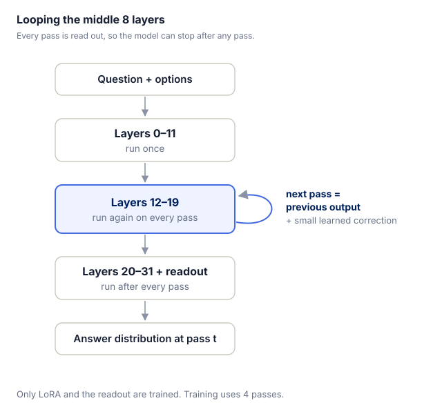
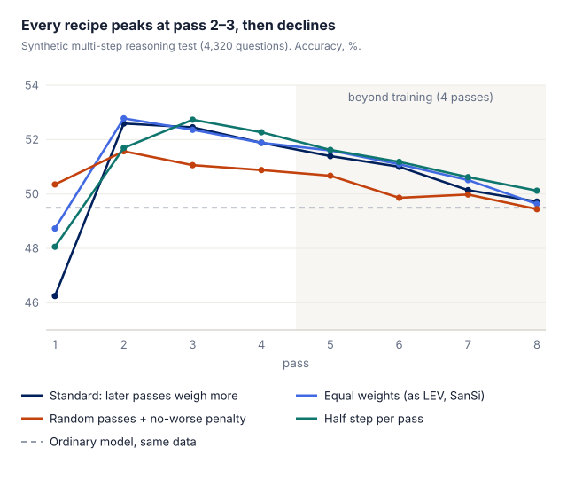

A decision model gives a probability for every option in one forward pass. It is fast, but the compute it can spend on a question is fixed, so questions that need several steps of reasoning are hard for it. We tried a cheap fix: no new pretraining, just LoRA, to let the middle layers of our existing 4B decision model run several times.

# 1 Takeaways

- **One extra pass helps.** On multi-step reasoning tasks it beats an ordinary model by 2–3 points, and loses nothing elsewhere.
- **More passes do not help overall.** After the third pass only the multi-step rule tasks still creep up; the rest get worse.
- **Changing the training recipe does not fix this.** We tried 5 variations; later passes stay useless.
- **The model cannot learn when to stop.** The best rule is simply to always run 2 passes.

This matches what [LEV](https://arxiv.org/abs/2610.20951) and [SanSi](https://arxiv.org/abs/2610.07730) found: the benefit of looping comes mainly from a base model that was pretrained to loop. Retrofitting an ordinary model gets you only a little.

# 2 The retrofit

***Figure 1** The first 12 layers run once, the middle 8 layers run again and again, and after every pass the last 12 layers read out an answer.*

The base is Qwen3.5-4B, with 32 layers. Each pass picks up from the result of the previous one. We train only LoRA and the readout head, with 4 passes during training. The comparison is an ordinary model trained on the same data with the same settings, but without looping.

# 3 One extra pass helps, more do not

| Evaluation | Pass 2 | Pass 4 |
| --- | --- | --- |
| Multi-step rule computation ([PTD](https://huggingface.co/datasets/tasksource/procedural-typed-decisions)) | +2.1 | +2.8 |
| DecisionPivot | +2.8 | +2.8 |
| Transfer | +2.1 | +0.1 |
| Synthetic decision set | +0.1 | −1.5 |

*Accuracy gain over the ordinary model, in points.*

Pass 2 leads reliably on multi-step reasoning and loses nothing elsewhere. By pass 4, only the multi-step rule tasks are still improving; the rest start to slip. Running more passes than in training makes it worse still.

# 4 Other training recipes do not help

On synthetic multi-step reasoning tasks we tried several training recipes, changing one thing at a time:

- **Weight every pass's loss equally, as LEV and SanSi do:** pass 1 gets better, pass 4 does not. The gain just moves earlier.
- **Run a random 1–4 passes each time and penalize getting worse:** the model learns to answer in the first pass, and later passes do almost nothing.
- **Take only half a step per pass:** the middle passes are a little steadier, but none clearly beats pass 2, and later passes still decline.
- **No retraining, smaller steps at inference:** fewer answers get broken, but fewer get fixed too; no pass beats pass 2.
- **A higher learning rate:** the ordinary model gains more, and looping's extra edge does not grow.

***Figure 2** The four recipes differ only at pass 1; all of them peak at pass 2–3 and then decline together.*

# 5 Why it cannot learn when to stop

We used the model's output probabilities and its internal states to predict whether one more pass would fix an answer. It did no better than guessing.

The reason is simple. The answers that change after pass 2 come almost entirely from questions the model was already unsure about. Another pass then amounts to re-tossing a coin between two close options, and since the original answer was the more likely one, it breaks more answers than it fixes. That is exactly what we see: 191 fixed and 305 broken, almost the same as expected if the later passes added no new information at all (191 and 321).

# 6 Compared with LEV and SanSi

- **Different bases.** Theirs were pretrained to loop ([Ouro](https://arxiv.org/abs/2510.25741), Nanbeige); ours is an ordinary model.
- **Different number of useful passes.** For them 2–3 extra passes help; for us only 1.
- **They also tried retrofitting ordinary models, without much luck.** LEV saw almost no change on Qwen3.5-0.8B, and SanSi saw no gain on SmolLM2-1.7B. Ours did a little better, but the gain is still small.
- **Too many passes flip answers back and forth and cost accuracy;** SanSi saw this too.

# 7 Limitations

The conclusion sits inside a narrow budget: LoRA only, twenty thousand rows or fewer. A larger LoRA, large-scale continued pretraining (the successful retrofits in the literature used billions to over a hundred billion tokens), or a base that already loops during pretraining would all change it.

This matches what LEV report: the gain from looping comes mainly from pretraining, where the model first learns to use the extra computation. Getting a plain base decision model to learn looping through simple post-hoc training is hard. In our runs one extra pass buys 2–3 points and the curve then flattens; our reading is that this is not a tuning problem but a signal problem — the training signal does not teach the model what to do with the extra compute.

# References

1\. Thinking Fast and Deep with Looped Decision Models (LEV). arXiv:2610.20951. [https://arxiv.org/abs/2610.20951](https://arxiv.org/abs/2610.20951)

2\. A Looped Typed Decision Model for System 1.5 Thinking (SanSi). arXiv:2610.07730. [https://arxiv.org/abs/2610.07730](https://arxiv.org/abs/2610.07730)

3\. Scaling Latent Reasoning via Looped Language Models (Ouro). arXiv:2510.25741. [https://arxiv.org/abs/2510.25741](https://arxiv.org/abs/2510.25741)

4\. tasksource/procedural-typed-decisions (PTD). [https://huggingface.co/datasets/tasksource/procedural-typed-decisions](https://huggingface.co/datasets/tasksource/procedural-typed-decisions)
