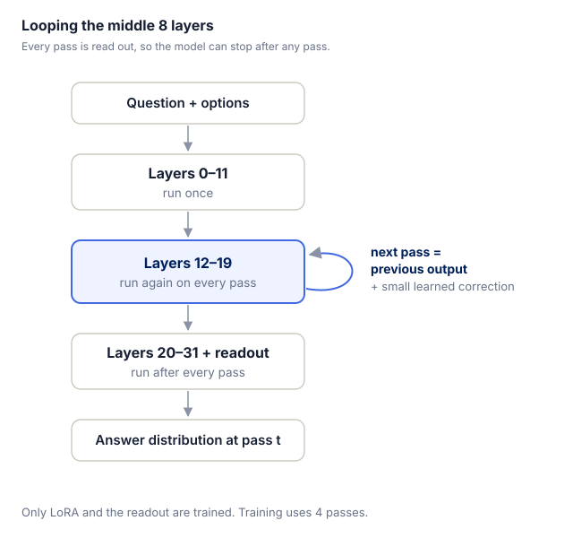
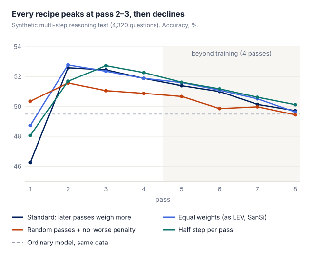

决策模型一次前向就给出每个选项的概率，很快，但每道题能用的计算量是固定的。碰到要推好几步的题，直接给答案就不够了，得想办法让模型在中间多想几步再答。

把思考过程写出来（显式的思维链）确实有用，但每一步都要生成 token，推理成本跟着变长，决策模型的优势就不复存在。更省的办法是在隐空间里想：不产出中间文字，让同一组层多转几遍，转完了还是走分类头出分。循环语言模型就是这么做的，参数不变，多转一轮就多一层深度；它的训练配方和算力开销，我们之前在[那篇笔记](../loop-compute-ledger/)里算过。

这篇要试的是把循环深度搬到决策模型上：不重新预训练，只训 LoRA，让现有 4B 决策模型的中间几层多转几遍，看推理能力会不会跟着变强，答案并不乐观，原因在后面。

# 1 结论

- **多转一遍有用。** 在多步推理题上比普通模型高 2–3 点，其他题上也没有掉分，可以放心多转，收益一点都不会掉。
- **再多转整体没用。** 第 3 遍以后，只有多步规则题还在小涨，其他题反而开始变差，整体收益被拖回去一截，最后基本白转。
- **换训练方法也改不了。** 我们试了 5 种改法，后面几遍还是没用。
- **模型学不会自己决定什么时候停。** 最好的规则就是固定转 2 遍。

这和 [LEV](https://arxiv.org/abs/2610.20951)、[SanSi](https://arxiv.org/abs/2610.07730) 的发现一致：循环的好处主要来自底座在预训练时就学会了循环。普通模型事后改造，只能拿到一点点。

# 2 怎么改

***图 1** 前 12 层跑一遍，中间 8 层反复跑，每跑完一遍就从后 12 层读出一次答案。*

底座是 Qwen3.5-4B，共 32 层。下一遍从上一遍的结果接着算。我们只训 LoRA 和读出头，训练时转 4 遍。对照组是用同样数据、同样设置训练、但不循环的普通模型。

# 3 多转一遍有用，再多就没用了

| 评测 | 第 2 遍 | 第 4 遍 |
| --- | --- | --- |
| 多步规则计算（[PTD](https://huggingface.co/datasets/tasksource/procedural-typed-decisions)） | +2.1 | +2.8 |
| DecisionPivot | +2.8 | +2.8 |
| Transfer | +2.1 | +0.1 |
| 合成决策题 | +0.1 | −1.5 |

*和普通模型比，准确率高几点。*

第 2 遍在多步推理题上稳定领先，别的题不掉分。到第 4 遍，只有多步规则题还在涨，其他题反而开始变差，整体收益被拖回去一截，最后基本白转。转得比训练时还多，就掉得更多，差距也拉得更开。

# 4 换训练方法也没用

我们在合成的多步推理题上试了几种训练方法，每次只改一处：

- **照 LEV、SanSi 的做法，每一遍的损失一样重：** 第 1 遍变好了，第 4 遍没变。好处只是把收益挪到了前面，总量没变。
- **每次随机转 1–4 遍，并惩罚"越转越差"：** 模型干脆学会第一遍就答完，后面几遍几乎没用，模型就在原地空转。
- **每一遍只走半步：** 前几遍稍稳一点，但没有明显超过第 2 遍，后面几遍照样往下掉。
- **不重训，推理时把步子缩小：** 改错的少了，改对的也少了，没有一遍能稳定超过第 2 遍。
- **调高学习率：** 普通模型涨得更多，循环的额外优势没有变大。

***图 2** 四种训练方法只在第 1 遍不一样，之后都在第 2–3 遍到顶，然后一起往下走。*

# 5 为什么学不会什么时候停

我们用模型的输出概率和内部状态，去预测"再转一遍会不会改对"，结果和瞎猜差不多，几乎没有区分度，派不上用场。

原因很简单：第 2 遍以后被改掉的答案，几乎都来自模型本来就拿不准的题。这时候再转一遍，相当于在两个差不多的选项之间重新掷一次硬币；而原答案本来就是概率最高的那个，所以改错会比改对多。实际正是这样：改对 191 道、改错 305 道，和"后几遍没带来任何新信息"时的预期（改对 191、改错 321）几乎一样，看不出差别。

# 6 和 LEV、SanSi 比

- **底座不同。** 它们的底座在预训练时就会循环（[Ouro](https://arxiv.org/abs/2510.25741)、Nanbeige），我们这边是普通模型，没有这个先验，只能事后补。
- **有用的遍数不同。** 它们多转 2–3 遍都有用，我们只有 1 遍。
- **它们也试过改造普通模型，同样不太行。** LEV 在 Qwen3.5-0.8B 上几乎没变化，SanSi 在 SmolLM2-1.7B 上没有收益。我们好一点，但幅度也很小，谈不上优势。
- **转多了来回改、掉分，** SanSi 也看到了。

# 7 局限

这个结论只落在一个很窄的预算里：只训 LoRA、数据两万条以内。更大的 LoRA、大规模继续预训练（文献里成功的改造用了几十亿到一千多亿 token），或者换一个在预训练阶段就会循环的底座，都可能把结论整个改到另一边去。

和 LEV 的结论类似，我们看到的也是这件事：循环的收益主要来自预训练，模型要先在预训练里学会怎么用这些额外的计算。想让一个普通基座决策模型靠事后简单训练学会循环，很难。我们的结果里，多转一遍能拿到 2–3 点，再往上就停在原地；我们更倾向于认为，这不是调参没到位，而是训练信号不足以教会模型怎么使用多出来的计算。

# 参考文献

1\. Thinking Fast and Deep with Looped Decision Models (LEV). arXiv:2610.20951. [https://arxiv.org/abs/2610.20951](https://arxiv.org/abs/2610.20951)

2\. A Looped Typed Decision Model for System 1.5 Thinking (SanSi). arXiv:2610.07730. [https://arxiv.org/abs/2610.07730](https://arxiv.org/abs/2610.07730)

3\. Scaling Latent Reasoning via Looped Language Models (Ouro). arXiv:2510.25741. [https://arxiv.org/abs/2510.25741](https://arxiv.org/abs/2510.25741)

4\. tasksource/procedural-typed-decisions (PTD). [https://huggingface.co/datasets/tasksource/procedural-typed-decisions](https://huggingface.co/datasets/tasksource/procedural-typed-decisions)
